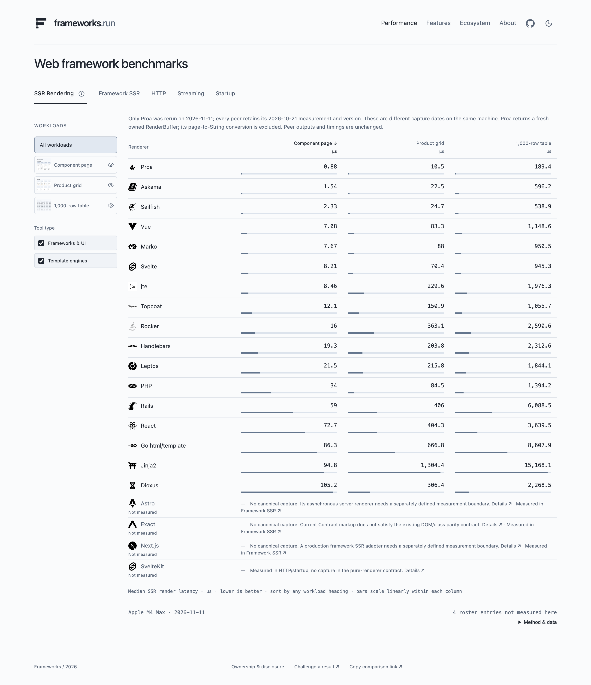

# Framework benchmarks

**[Explore the results → frameworks.run](https://frameworks.run)**

We run the same pages across web frameworks to help you compare rendering speed,
server capacity, and streaming latency before choosing a stack. The code,
correctness checks, and raw measurements are public.

## Reproduce or contribute

[Run a benchmark or add a framework](CONTRIBUTING.md).

[Rendering results](scoreboard.md) · [HTTP and streaming](http-capacity.md) · [Measurement rules](rendering/protocol.md)

Maintained by [Proa Labs](https://github.com/Proa-Labs). Proa is one of the measured frameworks.

[Apache-2.0](LICENSE) · [Third-party attribution](rendering/UPSTREAM_LICENSES.md)
