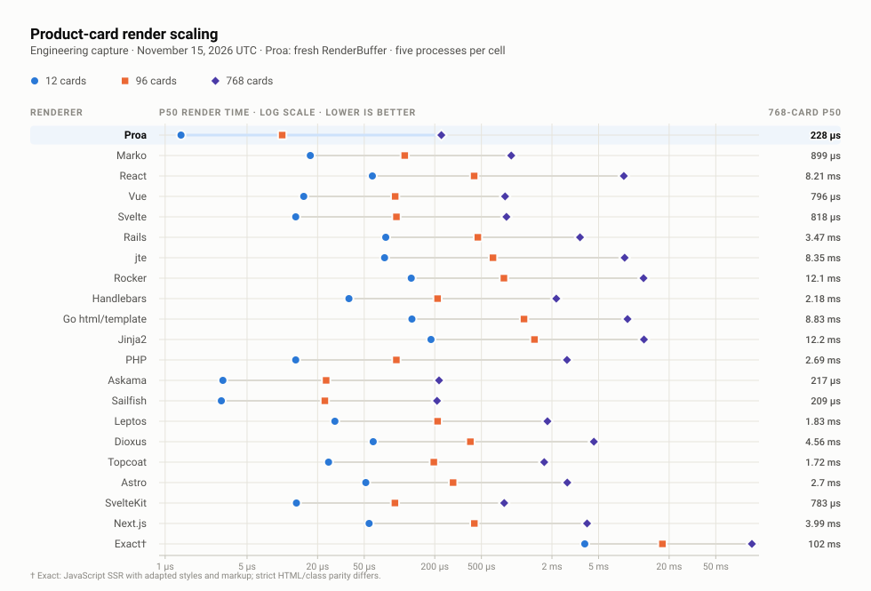
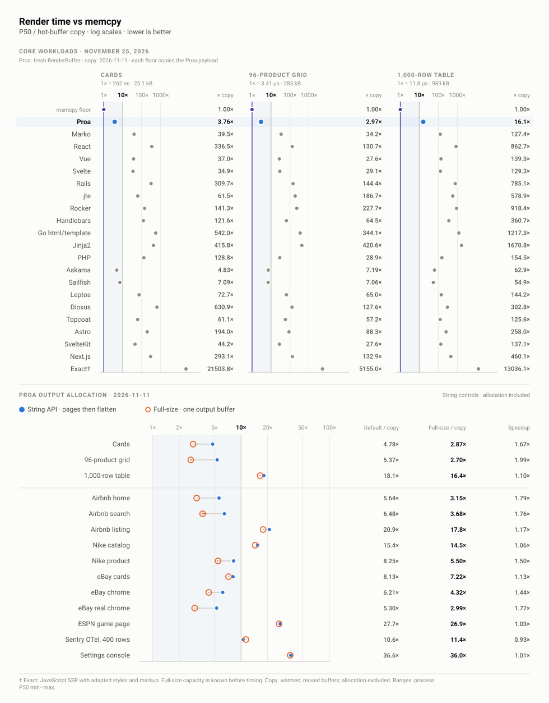
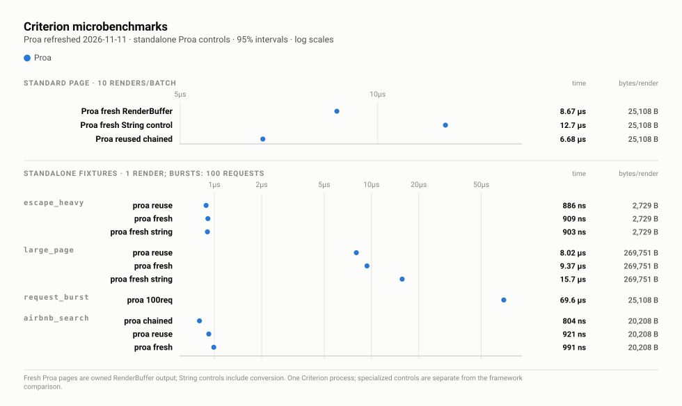
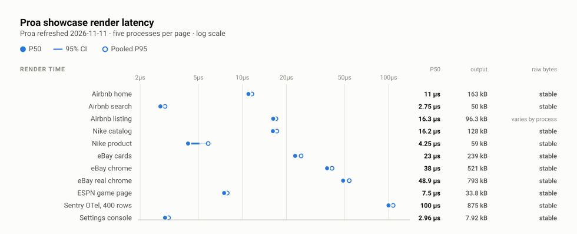

# Engineering and application captures

These captures answer narrower questions than the scoreboard, and each states its own measurement boundary. This page holds [product-grid scaling](#product-grid-scaling-capture), the [showcase memcpy floor](#showcase-memcpy-floor), [Proa's output-buffer allocation](#proa-output-buffer-allocation), the [client JavaScript reference](#client-javascript-reference), and the [latest standalone Proa engineering capture](#proa-engineering-refresh).

<!-- product-scaling:start -->
## Product-grid scaling capture

This November 15, 2026 UTC engineering capture repeats the canonical product-grid
contract at 12, 96, and 768 cards. Every value includes component/template
execution and a fresh independently owned response; deterministic input
construction remains outside timing. All 63 renderer/size cells passed the same
strict semantic-DOM gate or Exact’s explicitly adapted content-and-style gate. Exact† uses native named styles and different HTML; see [the adaptation notes](../../benchmarks/rendering/external/exact/README.md). Each cell below is
the median of 5 independent process P50s, using 2000, 500, and 100 measured
renders per process respectively.

| Renderer | 12 cards P50 | 96 cards P50 | 768 cards P50 |
| --- | ---: | ---: | ---: |
| Proa | 1.366 µs | 9.976 µs | 227.620 µs |
| Marko | 17.337 µs | 110.834 µs | 898.868 µs |
| React | 58.676 µs | 433.701 µs | 8.210 ms |
| Vue | 15.229 µs | 91.888 µs | 796.080 µs |
| Svelte | 13.011 µs | 94.165 µs | 817.946 µs |
| Rails | 76.322 µs | 466.253 µs | 3.471 ms |
| jte | 74.591 µs | 627.601 µs | 8.345 ms |
| Rocker | 125.991 µs | 778.027 µs | 12.092 ms |
| Handlebars | 37.025 µs | 211.328 µs | 2.178 ms |
| Go html/template | 127.678 µs | 1.155 ms | 8.826 ms |
| Jinja2 | 185.709 µs | 1.419 ms | 12.194 ms |
| PHP | 13.010 µs | 94.028 µs | 2.687 ms |
| Askama | 3.110 µs | 23.651 µs | 217.460 µs |
| Sailfish | 3.018 µs | 23.069 µs | 208.962 µs |
| Leptos | 28.100 µs | 211.433 µs | 1.830 ms |
| Dioxus | 59.644 µs | 402.624 µs | 4.559 ms |
| Topcoat | 24.809 µs | 196.286 µs | 1.718 ms |
| Astro | 51.564 µs | 286.596 µs | 2.702 ms |
| SvelteKit | 13.197 µs | 91.413 µs | 782.609 µs |
| Next.js | 55.042 µs | 435.248 µs | 3.987 ms |
| Exact† | 3.812 ms | 17.529 ms | 101.715 ms |

The 96-card column is an independent engineering capture, not a replacement
for the canonical result. Reproduce the matrix with
`./benchmarks/rendering/run-all --product-scaling`; the retained summary and per-process
measurements are in [`benchmarks/rendering/results/product-scaling.json`](../../benchmarks/rendering/results/product-scaling.json)
and [its raw process artifact](../../benchmarks/rendering/results/raw/product-scaling-v1-2026-11-15T22-53-54-804Z-43cbd657/process-summaries.json.gz).
<!-- product-scaling:end -->

*The canonical roster on one boundary: prepared data in, fresh independently owned HTML out. All 51 renderer/size cells passed semantic-DOM parity. Drawn from the [product-grid scaling capture](#product-grid-scaling-capture) · [Full size](../figures/05-product-card-scaling.svg) · [how the figures are built](../../tooling/charts/)*

The next two captures ask how close Proa's render sits to the cost of copying its own output, starting with the [showcase memcpy floor](#showcase-memcpy-floor).

<!-- showcase-memcpy:start -->
## Showcase memcpy floor

| Memcpy capture | Date (UTC) | Proa revision |
| --- | --- | --- |
| All 12 linked pages | November 11, 2026 | `bbbc96843351` |

Complete Proa page rendering against a hot-buffer copy of that page's exact
pre-rendered HTML. Each cell is the median of five process P50s; brackets show
their min–max range. Rendering includes page construction and fresh output
allocation. Copying reuses warmed source and destination buffers and excludes
allocation. All linked pages are included: **7 of 12 are within 10×** in this capture.

| Showcase page | Output bytes | Proa P50 µs [min–max] | Memcpy P50 µs [min–max] | Proa / memcpy |
| --- | ---: | ---: | ---: | ---: |
| Airbnb parity | 149,567 | 171.584 [170.709–173.667] | 1.475 [1.438–1.487] | 116.36× |
| Airbnb home | 162,883 | 11.042 [11.000–11.125] | 1.954 [1.924–1.972] | 5.65× |
| Airbnb search | 49,996 | 2.792 [2.750–2.792] | 0.436 [0.432–0.447] | 6.40× |
| Airbnb listing | 96,250 | 16.375 [16.250–16.667] | 0.783 [0.776–0.785] | 20.91× |
| Nike catalog | 128,294 | 16.334 [16.042–16.542] | 1.046 [1.036–1.052] | 15.61× |
| Nike product | 59,042 | 4.250 [4.125–4.250] | 0.499 [0.494–0.513] | 8.51× |
| eBay cards | 239,235 | 23.125 [23.042–23.416] | 2.843 [2.834–2.914] | 8.13× |
| eBay chrome | 521,326 | 38.042 [37.958–39.125] | 6.222 [6.169–6.369] | 6.11× |
| eBay real chrome | 793,226 | 49.375 [48.833–49.375] | 9.453 [9.229–9.483] | 5.22× |
| ESPN game page | 33,765 | 7.750 [7.625–7.917] | 0.282 [0.279–0.283] | 27.51× |
| Sentry OTel, 400 rows | 875,478 | 100.667 [99.375–101.667] | 10.313 [10.181–10.454] | 9.76× |
| Settings console | 7,925 | 2.959 [2.916–3.125] | 0.080 [0.078–0.084] | 36.79× |

Render and copy cells run in seeded randomized blocks, one fresh process per
page and mode in each of five repeats. Rendering uses 1,000 warmups and 10,000
samples (Sentry: 100 and 300); copying uses 200 warmup batches and 2,000 measured
batches of at least 16 MiB, divided by copies per batch. Byte counts and canonical
document hashes must agree across every process and both modes.

These are Proa-only application fixtures; no equivalent React capture is available
here. They are separate from the dated core matrix and canonical scoreboard.
The [retained capture](../../experiments/showcase/results/memcpy-floor.json) includes per-process
measurements, source hashes, host details and the linked binary SHA-256.
See [reproduction instructions](../../experiments/showcase/README.md#memcpy-floor).
<!-- showcase-memcpy:end -->

<!-- proa-buffers:start -->
## Proa output-buffer allocation

| Buffer capture | Date (UTC) | Proa revision |
| --- | --- | --- |
| 14 workloads · five processes per cell | 2026-11-11 | `bbbc96843351` |

This is an explicit **String-output control**, not the native RenderBuffer
scoreboard lane. The default String API uses its 4 KiB chained writer and then
flattens its pages into a String. The full-size String variant allocates a
fresh contiguous output buffer for every render, with capacity set to the final
HTML byte count measured before timing. Allocation, page construction and
runtime-tag insertion are timed; response destruction is outside both timings.
Memcpy copies the same HTML into a warmed reusable buffer with allocation excluded.

| Buffer comparison workload | Output bytes | Default P50 µs [min–max] | Full-size P50 µs [min–max] | Copy P50 µs [min–max] | Default / copy | Full-size / copy | Speedup |
| --- | ---: | ---: | ---: | ---: | ---: | ---: | ---: |
| Cards | 25,108 | 1.250 [1.250–1.292] | 0.750 [0.750–0.750] | 0.262 [0.260–0.317] | 4.78× | 2.87× | 1.67× |
| 96-product grid | 284,908 | 18.333 [18.208–18.459] | 9.209 [9.125–9.417] | 3.412 [3.379–3.417] | 5.37× | 2.70× | 1.99× |
| 1,000-row table | 988,509 | 213.250 [212.125–214.917] | 193.208 [189.958–194.500] | 11.755 [11.728–11.775] | 18.14× | 16.44× | 1.10× |
| Airbnb home | 162,883 | 11.042 [11.000–11.083] | 6.167 [6.166–6.208] | 1.956 [1.950–1.958] | 5.64× | 3.15× | 1.79× |
| Airbnb search | 49,996 | 2.792 [2.791–2.834] | 1.583 [1.541–1.750] | 0.431 [0.425–0.453] | 6.48× | 3.68× | 1.76× |
| Airbnb listing | 96,250 | 16.375 [16.375–16.500] | 13.958 [13.833–14.084] | 0.784 [0.775–0.786] | 20.90× | 17.81× | 1.17× |
| Nike catalog | 128,294 | 16.125 [16.042–16.167] | 15.167 [15.041–15.250] | 1.047 [1.045–1.054] | 15.40× | 14.49× | 1.06× |
| Nike product | 59,042 | 4.125 [4.125–4.291] | 2.750 [2.667–2.750] | 0.500 [0.494–0.508] | 8.25× | 5.50× | 1.50× |
| eBay cards | 239,235 | 23.208 [23.084–23.500] | 20.625 [20.542–20.875] | 2.856 [2.836–2.882] | 8.13× | 7.22× | 1.13× |
| eBay chrome | 521,326 | 38.583 [38.458–38.834] | 26.833 [26.667–27.166] | 6.210 [6.148–6.223] | 6.21× | 4.32× | 1.44× |
| eBay real chrome | 793,226 | 49.792 [49.541–50.125] | 28.083 [27.834–28.166] | 9.398 [9.384–9.508] | 5.30× | 2.99× | 1.77× |
| ESPN game page | 33,765 | 7.709 [7.625–7.834] | 7.500 [7.417–7.583] | 0.278 [0.276–0.280] | 27.69× | 26.94× | 1.03× |
| Sentry OTel, 400 rows | 875,478 | 110.166 [108.542–110.583] | 118.375 [115.959–119.500] | 10.421 [10.371–10.488] | 10.57× | 11.36× | 0.93× |
| Settings console | 7,925 | 2.917 [2.916–2.958] | 2.875 [2.875–3.000] | 0.080 [0.078–0.083] | 36.57× | 36.04× | 1.01× |

Cells run in seeded randomized blocks, with five fresh processes per workload
and mode. Values are medians of process P50s; ranges show their min–max.
Every process verifies equal output bytes and canonical HTML, and the full-size
buffer must keep its original capacity through every measured render.
The exact-size hint is an experimental input, not knowledge available to every
production request. The comparison changes the output writer as well as its
allocation strategy. See the [retained capture](../../experiments/showcase/results/buffer-comparison.json)
and [reproduction instructions](../../experiments/showcase/README.md#output-buffer-comparison).
<!-- proa-buffers:end -->

*Memcpy multiples and Proa's full-size allocation comparison. The core panel automatically reads the [current canonical measurements](scoreboard.md#detailed-measurements) and the [matched memcpy controls](#proa-output-buffer-allocation). PROA returns fresh owned RenderBuffer pages; peer dates and copy dates are shown in the figure. Render and copy are separate captures, and each floor copies the Proa payload, which can differ in size from peers. The lower panel retains the explicitly labeled String-output controls. Sources: the current canonical table and matched Proa allocation measurements · [Full size](../figures/03-representative-matrix.svg) · [how the figures are built](../../tooling/charts/)*

*Latest standalone Proa Criterion measurements, with each response size beside it. Drawn from the [latest engineering capture](#proa-engineering-refresh) · [Full size](../figures/04-criterion-microbenchmarks.svg) · [how the figures are built](../../tooling/charts/)*

## Client JavaScript reference

This repository's agent-chain fixture uses React 19, `hydrateRoot`, and an interactive form workflow. The row below measures its production minified ESM bundle with the benchmark's synthetic 64 KiB transfer padding excluded. It implements different behavior from the Proa showcase pages, so these measurements do not support a framework payload comparison.

| Client reference | JS requests | Raw bytes | Gzip-9 bytes | Brotli-11 bytes |
| --- | ---: | ---: | ---: | ---: |
| React 19 SSR hydration fixture | 1 | 195,379 | 61,110 | 52,426 |

Recompute it with `bun run bench:react-hydration-payload`. `bun run refresh` updates the table using the pinned Bun runtime; compressed byte sizes depend on the compressor implementation.

*Eleven pages from the [linked showcase corpus](#refreshed-linked-showcase-corpus) · [Full size](../figures/06-showcase-corpus.svg) · [how the figures are built](../../tooling/charts/)*

<!-- proa-engineering:start -->
## PROA engineering refresh

**2026-11-11 UTC** · Proa `bbbc9684335109949257eea8b4c98bb7bc8572ae` · Apple M4 Max.
This is the latest standalone PROA engineering capture. It is separate from the current same-host framework comparison; superseded peer measurements have been removed. Fresh canonical, standard-page, targeted `proa_fresh`, and product-grid `proa_owned_full` lanes now return an independently owned **RenderBuffer**, including context/page allocation and destruction, with no final String copy. The `fresh_owned_string`, `proa_fresh_string`, and `proa_owned_string` rows retain the former String conversion as explicit controls. Flattening for byte equality happens before timing. The optimizer sees the complete output owner. Other upstream showcase String-returning APIs, integer Vec lanes, and reused controls retain their declared boundaries. This boundary change is distinct from a framework optimization. Batch sizes and sample policies remain as declared in each fixture. Intervals are Criterion's 95% slope intervals (mean intervals for flat sampling). The [retained estimates and samples](../../benchmarks/rendering/results/proa-pr83-criterion.json) contain all 44 measured PROA rows and the reproduction command.

| Refreshed standard-page row | Output bytes/render | Raw time, µs/10 renders |
| --- | ---: | ---: |
| Proa fresh RenderBuffer | 25,108 | 8.6323 / 8.6661 / 8.7069 |
| Proa fresh String control | 25,108 | 12.6126 / 12.6870 / 12.7644 |
| Proa reused chained | 25,108 | 6.6527 / 6.6840 / 6.7178 |

| Refreshed Criterion row | Output bytes | Raw time, µs |
| --- | ---: | ---: |
| `escape_heavy/proa_reuse` | 2,729 | 0.8822 / 0.8857 / 0.8893 |
| `escape_heavy/proa_fresh` | 2,729 | 0.9065 / 0.9092 / 0.9123 |
| `escape_heavy/proa_fresh_string` | 2,729 | 0.9001 / 0.9030 / 0.9066 |
| `large_page/proa_reuse` | 269,751 | 7.9945 / 8.0152 / 8.0381 |
| `large_page/proa_fresh` | 269,751 | 9.3172 / 9.3664 / 9.4507 |
| `large_page/proa_fresh_string` | 269,751 | 15.6447 / 15.6919 / 15.7515 |
| `request_burst/proa_100req` | 25,108/request | 69.3704 / 69.6055 / 69.8765 |
| `airbnb_search/proa_chained` | 20,208 | 0.8000 / 0.8035 / 0.8074 |
| `airbnb_search/proa_reuse` | 20,208 | 0.9175 / 0.9207 / 0.9241 |
| `airbnb_search/proa_fresh` | 20,208 | 0.9860 / 0.9910 / 0.9968 |
| `showcase/home_proa_chained` | 162,883 | 6.1798 / 6.1986 / 6.2222 |
| `showcase/search_proa_chained` | 49,996 | 1.4764 / 1.4816 / 1.4878 |
| `showcase/listing_proa_chained` | 96,250 | 12.9787 / 13.0419 / 13.1122 |
| `showcase/nike_catalog_proa_fresh` | 128,294 | 16.5797 / 16.6446 / 16.7156 |
| `showcase/nike_catalog_proa_reused` | 128,294 | 13.0952 / 13.1500 / 13.2119 |
| `showcase/nike_product_proa_fresh` | 59,042 | 4.2393 / 4.2655 / 4.2956 |
| `showcase/nike_product_proa_reused` | 59,042 | 2.5682 / 2.5806 / 2.5946 |
| `showcase/ebay_cards_60_proa_fresh` | 239,235 | 22.8410 / 22.9401 / 23.0750 |
| `showcase/ebay_cards_60_proa_reused` | 239,235 | 15.5533 / 15.6307 / 15.7294 |
| `showcase/ebay_chrome_60_proa_fresh` | 521,326 | 38.8461 / 39.0172 / 39.1983 |
| `showcase/ebay_real_chrome_60_proa_fresh` | 793,226 | 52.0461 / 53.2973 / 55.1041 |
| `showcase/sentry_otel_400_proa_fresh` | 874,615 | 101.6217 / 102.0236 / 102.4362 |

The [data table](../../benchmarks/rendering/results/proa-pr83-data_table_bench.json), [marketplace SRP](../../benchmarks/rendering/results/proa-pr83-ebay_srp_bench.json), and [synthetic listings](../../benchmarks/rendering/results/proa-pr83-ebay_srp_real_bench.json) standalone PROA fixtures were rerun at their default sample counts. Superseded cross-language comparisons are available in Git history.

The integer and product-grid controls below were also rerun for PROA only. Values are µs per render; fresh and reused ownership remain separate.

| PROA benchmark ID | Raw time, µs |
| --- | ---: |
| `integer_serialization_fresh_owned/proa/1` | 0.1214 / 0.1220 / 0.1229 |
| `integer_serialization_fresh_owned/proa/10` | 0.4313 / 0.4336 / 0.4360 |
| `integer_serialization_fresh_owned/proa/100` | 4.1329 / 4.1481 / 4.1645 |
| `integer_serialization_fresh_owned/proa/1000` | 42.7534 / 42.9921 / 43.2635 |
| `integer_serialization_fresh_owned/proa/10000` | 429.8900 / 432.0955 / 434.7388 |
| `integer_serialization_reused_contiguous/proa/1` | 0.0317 / 0.0318 / 0.0320 |
| `integer_serialization_reused_contiguous/proa/10` | 0.3414 / 0.3429 / 0.3450 |
| `integer_serialization_reused_contiguous/proa/100` | 3.5220 / 3.5350 / 3.5489 |
| `integer_serialization_reused_contiguous/proa/1000` | 35.5383 / 35.6659 / 35.8288 |
| `integer_serialization_reused_contiguous/proa/10000` | 365.6026 / 367.2939 / 369.2718 |
| `topcoat_upstream_product_grid/proa_owned_full/12` | 1.3749 / 1.3837 / 1.3952 |
| `topcoat_upstream_product_grid/proa_owned_full/768` | 92.8337 / 93.3012 / 93.8906 |
| `topcoat_upstream_product_grid/proa_owned_full/96` | 11.6328 / 11.6867 / 11.7460 |
| `topcoat_upstream_product_grid/proa_owned_string/12` | 2.1921 / 2.2031 / 2.2152 |
| `topcoat_upstream_product_grid/proa_owned_string/768` | 148.9948 / 149.9883 / 150.9165 |
| `topcoat_upstream_product_grid/proa_owned_string/96` | 19.5497 / 19.7927 / 20.2333 |
| `topcoat_upstream_product_grid/proa_reused_chained_full/12` | 1.0750 / 1.0812 / 1.0875 |
| `topcoat_upstream_product_grid/proa_reused_chained_full/768` | 77.7763 / 78.2285 / 78.7189 |
| `topcoat_upstream_product_grid/proa_reused_chained_full/96` | 9.6020 / 9.6524 / 9.7003 |

### Refreshed linked showcase corpus

The locked deployable fixture covers all twelve pages, five independent processes per page, with the original warmup and iteration counts. Raw byte variation is retained separately from canonical JSON-key-order equivalence. The process summaries, binary/source digests and compressed raw-sample link are in [the SSR artifact](../../experiments/showcase/results/ssr-pr83.json). The [browser JavaScript capture](../../experiments/showcase/results/client-js-pr83.json) also reruns all four interactive pages under both desktop and 4× CPU-throttled mobile profiles, with 30 recorded navigations per page/profile. Figure 06 uses these new samples; superseded application captures are available in Git history.

| Refreshed showcase page | Output bytes | Recorded renders | Process-median P50 µs [95% CI] | Pooled P95 µs | Raw bytes stable? |
| --- | ---: | ---: | ---: | ---: | --- |
| Airbnb parity | 149,567 | 50,000 | 169.375 [168.458, 175.041] | 183.542 | yes |
| Airbnb home | 162,883 | 50,000 | 11.000 [10.958, 11.125] | 11.625 | yes |
| Airbnb search | 49,996 | 50,000 | 2.750 [2.750, 2.792] | 2.958 | yes |
| Airbnb listing | 96,250 | 50,000 | 16.250 [16.125, 16.333] | 16.959 | no; 5 raw hashes, 1 canonical hash |
| Nike catalog | 128,294 | 50,000 | 16.167 [16.042, 16.458] | 17.209 | yes |
| Nike product | 59,042 | 50,000 | 4.250 [4.250, 5.084] | 5.834 | yes |
| eBay cards | 239,235 | 50,000 | 22.959 [22.917, 23.000] | 25.208 | yes |
| eBay chrome | 521,326 | 50,000 | 37.958 [37.791, 37.959] | 41.041 | yes |
| eBay real chrome | 793,226 | 50,000 | 48.875 [48.792, 49.000] | 53.834 | yes |
| ESPN game page | 33,765 | 50,000 | 7.500 [7.458, 7.542] | 7.875 | yes |
| Sentry OTel, 400 rows | 875,478 | 1,500 | 99.875 [98.458, 101.125] | 107.419 | yes |
| Settings console | 7,925 | 50,000 | 2.958 [2.917, 2.958] | 3.125 | yes |
<!-- proa-engineering:end -->

## Next steps

- [Front page](../../README.md)
  - The four figures and the reasons to trust them.
- [Canonical scoreboard evidence](scoreboard.md)
  - The current same-host renderer comparison.
- [Memcpy floor analysis](../engineering/memcpy-floor.md) and [buffer strategies](../engineering/proa-buffer-strategies.md)
  - The design of the copy floor and allocation measurements.
- [Showcase suite](../../experiments/showcase/), [agent chain](../../experiments/agent-chain/), and [travel agent](../../experiments/travel-agent/)
  - Reproduction instructions for the application, browser, and agent captures.
