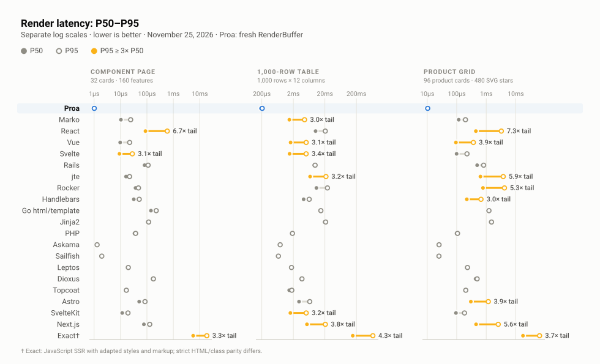

# Canonical scoreboard evidence

Seventeen renderers turn the same prepared data into the same three pages, and the scoreboard times only that render. This page holds the [current result](#current-result), the [renderer coverage](#renderer-coverage), and the [complete canonical evidence](#complete-canonical-evidence) behind the [front page](../../README.md)'s figures.

## Current result

<!-- canonical-scoreboard:start -->

**November 15, 2026 · Intel(R) Xeon(R) 6985P-C CPU @ 2.30GHz · linux**

On these workloads, the November 15, 2026 capture on Intel(R) Xeon(R) 6985P-C CPU @ 2.30GHz measured Proa rendering the component page 75.2× faster than React, the 1,000-row table 37.8× faster than React, and the product grid 33.5× faster than React. These ratios describe this capture, not every application.

> Lower is better. Strict rows pass unchanged DOM/class parity. Exact† uses an explicitly adapted fixture with equivalent content and native styles; its HTML differs. See [adaptation details](../../benchmarks/rendering/external/exact/README.md).

Each cell is `P50 render time · relative to Proa`.

| Renderer | Component page | 1,000-row table | Product grid | Airbnb landing page | Nike catalog | GitHub PR review | Sentry logs | ESPN game page |
| --- | ---: | ---: | ---: | ---: | ---: | ---: | ---: | ---: |
| Proa | 0.001 ms · 1.00× | 0.24 ms · 1.00× | 0.013 ms · 1.00× | 0.014 ms · 1.00× | 0.032 ms · 1.00× | 0.19 ms · 1.00× | 0.33 ms · 1.00× | 0.006 ms · 1.00× |
| Marko | 0.010 ms · 9.54× | 1.41 ms · 5.81× | 0.11 ms · 8.64× | 0.091 ms · 6.26× | 0.22 ms · 6.91× | 5.02 ms · 26.3× | 10.9 ms · 33.4× | 0.095 ms · 15.0× |
| React | 0.082 ms · 75.2× | 9.15 ms · 37.8× | 0.44 ms · 33.5× | 0.50 ms · 34.4× | 0.57 ms · 18.0× | 3.16 ms · 16.5× | 9.90 ms · 30.3× | 0.25 ms · 38.9× |
| Vue | 0.010 ms · 9.00× | 1.56 ms · 6.45× | 0.093 ms · 7.14× | 0.065 ms · 4.49× | 0.12 ms · 3.64× | 1.03 ms · 5.41× | 2.79 ms · 8.55× | 0.057 ms · 8.96× |
| Svelte | 0.009 ms · 7.97× | 1.49 ms · 6.16× | 0.091 ms · 7.00× | 0.076 ms · 5.27× | 0.12 ms · 3.88× | 0.76 ms · 4.00× | 2.71 ms · 8.30× | 0.083 ms · 13.1× |
| Rails | 0.076 ms · 69.7× | 9.00 ms · 37.1× | 0.46 ms · 35.1× | 0.34 ms · 23.8× | 0.88 ms · 27.5× | 5.30 ms · 27.7× | 12.2 ms · 37.3× | 0.32 ms · 50.3× |
| jte | 0.021 ms · 19.3× | 6.66 ms · 27.5× | 0.63 ms · 48.3× | 0.092 ms · 6.33× | 0.28 ms · 8.68× | 2.26 ms · 11.8× | 5.28 ms · 16.2× | 0.077 ms · 12.1× |
| Rocker | 0.036 ms · 32.6× | 8.29 ms · 34.2× | 0.76 ms · 58.5× | 0.42 ms · 29.3× | 0.67 ms · 20.9× | 5.32 ms · 27.8× | 5.57 ms · 17.1× | 0.29 ms · 46.3× |
| Handlebars | 0.032 ms · 28.8× | 4.07 ms · 16.8× | 0.21 ms · 16.0× | 0.46 ms · 31.6× | 1.06 ms · 33.3× | 17.3 ms · 90.3× | 14.1 ms · 43.2× | 0.38 ms · 59.2× |
| Go html/template | 0.14 ms · 128× | 14.2 ms · 58.4× | 1.15 ms · 88.8× | 1.59 ms · 110× | 5.17 ms · 162× | 32.0 ms · 168× | 69.3 ms · 212× | 1.30 ms · 204× |
| Jinja2 | 0.11 ms · 96.8× | 19.2 ms · 79.2× | 1.42 ms · 110× | 0.63 ms · 43.6× | 1.78 ms · 55.7× | 11.0 ms · 57.6× | 24.4 ms · 74.8× | 0.56 ms · 87.8× |
| PHP | 0.033 ms · 30.2× | 1.77 ms · 7.31× | 0.094 ms · 7.26× | 0.24 ms · 16.9× | 0.40 ms · 12.4× | 2.79 ms · 14.6× | 5.85 ms · 17.9× | 0.28 ms · 43.5× |
| Askama | 0.001 ms · 1.11× | 0.74 ms · 3.05× | 0.024 ms · 1.84× | 0.014 ms · 0.95× | 0.034 ms · 1.08× | 0.21 ms · 1.12× | 0.39 ms · 1.19× | 0.007 ms · 1.09× |
| Sailfish | 0.002 ms · 1.73× | 0.64 ms · 2.62× | 0.024 ms · 1.82× | 0.007 ms · 0.47× | 0.016 ms · 0.50× | 0.11 ms · 0.57× | 0.26 ms · 0.78× | 0.005 ms · 0.73× |
| Leptos | 0.017 ms · 15.8× | 1.72 ms · 7.09× | 0.26 ms · 19.8× | 0.13 ms · 8.89× | 0.18 ms · 5.67× | 0.84 ms · 4.41× | 1.41 ms · 4.33× | 0.035 ms · 5.56× |
| Dioxus | 0.17 ms · 151× | 3.43 ms · 14.1× | 0.42 ms · 32.2× | 0.91 ms · 62.8× | 2.26 ms · 70.6× | 16.4 ms · 85.9× | 22.6 ms · 69.2× | 0.59 ms · 92.7× |
| Topcoat | 0.016 ms · 14.6× | 1.47 ms · 6.05× | 0.19 ms · 14.8× | 0.31 ms · 21.2× | 0.51 ms · 16.0× | 2.67 ms · 14.0× | 4.61 ms · 14.1× | 0.13 ms · 21.1× |
| Astro | 0.049 ms · 44.8× | 2.94 ms · 12.1× | 0.28 ms · 21.8× | 0.34 ms · 23.7× | 0.76 ms · 23.7× | 5.04 ms · 26.4× | 17.1 ms · 52.5× | 0.30 ms · 46.6× |
| SvelteKit | 0.012 ms · 10.6× | 1.66 ms · 6.85× | 0.089 ms · 6.89× | 0.058 ms · 3.98× | 0.14 ms · 4.40× | 0.77 ms · 4.03× | 3.14 ms · 9.62× | 0.053 ms · 8.38× |
| Next.js | 0.075 ms · 68.8× | 4.90 ms · 20.2× | 0.41 ms · 31.4× | 0.54 ms · 37.1× | 0.63 ms · 19.8× | 3.56 ms · 18.6× | 10.4 ms · 31.7× | 0.28 ms · 44.0× |
| Exact† | 5.48 ms · 5004× | 147 ms · 608× | 17.2 ms · 1324× | 53.6 ms · 3703× | 98.4 ms · 3077× | 441 ms · 2308× | 1375 ms · 4215× | 43.3 ms · 6800× |

Rows use the fixed order in [the canonical roster](../../benchmarks/rendering/canonical/roster.json); columns are never ranked independently.
<!-- canonical-scoreboard:end -->

### How to read the scoreboard

- **Two kinds of renderer share the table.** Proa, React, Vue, Svelte, Marko, Leptos, Dioxus, and Topcoat are component frameworks with a component model and, in most cases, streaming and client interactivity. Askama, Sailfish, jte, Rocker, Handlebars, Go `html/template`, Jinja2, PHP, and Rails Action View are template engines. In the PROA-only refresh, Proa has the lowest P50 on all three workloads, including against the retained Askama and Sailfish rows. Peer results retain their original capture date.
- **Contrary cells stay.** The refreshed Proa row leads Askama and Sailfish on all three P50s; their original measurements remain in the table. Both emit a 44,849-byte component page against Proa's 25,108 bytes because their templates keep authored whitespace. The semantic DOM is identical, and the byte counts are in the detailed table.
- **Ratios are per capture.** The multiples describe this machine and these three pages. The [HTTP captures](http-capacity.md) translate them into per-core capacity, which is the portable number.

### The three workloads

| Workload | Fixed shape |
| --- | --- |
| Component page | 4 sections, 32 cards, and 160 feature-list items |
| 1,000-row table | 12 columns with escaping, formatting, branches, and variable-length lists |
| Product grid | 96 product cards and 480 SVG stars |

The same deterministic input objects feed every adapter, and input and template construction happen before timing.

### Fairness rules

- Each listed renderer implements all three workloads and uses one pinned canonical runtime.
- Production or release builds return one complete, independently owned response per measured render.
- Routing, middleware, databases, HTTP transfer, hydration, and network latency are outside the scoreboard measurement; the HTTP sections state what they add back.
- Every adapter must pass the shared browser-DOM parity gate before any timing starts.
- Serializer metadata may differ where unavoidable; the detailed report records payload differences and exact-byte matches.

### Reading the adapters

Each renderer's page is real code in this repository, written the way its documentation recommends. Judge fairness by reading the product-grid implementations side by side:

| Renderer | Product grid source | HTTP server |
| --- | --- | --- |
| Proa | [`benchmarks/rendering/src/topcoat_product_grid.rs`](../../benchmarks/rendering/src/topcoat_product_grid.rs) | [`benchmarks/rendering/src/bin/proa_page_server.rs`](../../benchmarks/rendering/src/bin/proa_page_server.rs) |
| React | [`benchmarks/rendering/external/react/suite_components.mjs`](../../benchmarks/rendering/external/react/suite_components.mjs) | [`benchmarks/http/react_server.mjs`](../../benchmarks/http/react_server.mjs) |
| Marko | [`benchmarks/rendering/external/marko/suite_products.marko`](../../benchmarks/rendering/external/marko/suite_products.marko) | [`benchmarks/rendering/external/marko/page_server.mjs`](../../benchmarks/rendering/external/marko/page_server.mjs) |
| Go html/template | [`benchmarks/rendering/external/go/suite_bench.go`](../../benchmarks/rendering/external/go/suite_bench.go) | same file, `--serve` |
| Rails, jte, Rocker, Handlebars, Jinja2, PHP | [`benchmarks/rendering/external/`](../../benchmarks/rendering/external/) | scoreboard only |
| Askama, Sailfish, Leptos, Dioxus, Topcoat | [`benchmarks/rendering/src/`](../../benchmarks/rendering/src/) | scoreboard only |

The Proa product card is an ordinary typed component, and the React card is the same markup as `createElement` calls. Both are what a team would write, and both produce the same DOM:

```rust filename="benchmarks/rendering/src/topcoat_product_grid.rs"
impl<B: WriteBuf, L: DataLoader> WebRenderSync<L, B> for ProaProductCard<'_> {
    fn render(self, cx: &mut WebContext<L, B>) -> Result<(), WriteError> {
        let product = self.product;
        html_sync! {
            <a href={ProductUrl(product.id)} class="group flex flex-col rounded-xl border border-slate-200 bg-white p-4 shadow-sm transition hover:shadow-md">
                <div class="mb-4 flex h-32 items-center justify-center rounded-lg bg-slate-100 text-3xl font-bold text-slate-300">{text(&product.category)}</div>
                <p class="text-xs font-medium uppercase tracking-wide text-slate-400">{text(&product.category)}</p>
                <h3 class="mt-1 text-sm font-semibold text-slate-900 group-hover:text-indigo-600">{text(&product.name)}</h3>
                <div class="mt-2 flex items-center gap-1">
                    {ProaRatingStars(product.rating_tenths)}
                    <span class="text-xs text-slate-500">{Rating(product.rating_tenths)}" ("{product.review_count}")"</span>
                </div>
                <p class="mt-3 text-lg font-bold">{Price(product.price_cents)}</p>
            </a>
        }
        .render(cx)
    }
}
```

[Renderer coverage](#renderer-coverage) records which renderers are in the roster and which cells passed.

## Renderer coverage

<!-- canonical-coverage:start -->
| Renderer | Status | Detail |
| --- | --- | --- |
| Proa | Included | All 8 workloads passed parity in this capture. |
| Marko | Included | All 8 workloads passed parity in this capture. |
| React | Included | All 8 workloads passed parity in this capture. |
| Vue | Included | All 8 workloads passed parity in this capture. |
| Svelte | Included | All 8 workloads passed parity in this capture. |
| Rails | Included | All 8 workloads passed parity in this capture. |
| jte | Included | All 8 workloads passed parity in this capture. |
| Rocker | Included | All 8 workloads passed parity in this capture. |
| Handlebars | Included | All 8 workloads passed parity in this capture. |
| Go html/template | Included | All 8 workloads passed parity in this capture. |
| Jinja2 | Included | All 8 workloads passed parity in this capture. |
| PHP | Included | All 8 workloads passed parity in this capture. |
| Askama | Included | All 8 workloads passed parity in this capture. |
| Sailfish | Included | All 8 workloads passed parity in this capture. |
| Leptos | Included | All 8 workloads passed parity in this capture. |
| Dioxus | Included | All 8 workloads passed parity in this capture. |
| Topcoat | Included | All 8 workloads passed parity in this capture. |
| Astro | Included | All 8 workloads passed parity in this capture. |
| SvelteKit | Included | All 8 workloads passed parity in this capture. |
| Next.js | Included | All 8 workloads passed parity in this capture. |
| Exact | Included | All 8 adapted workloads passed content and style checks; HTML differs. See the Exact adaptation notes. |
<!-- canonical-coverage:end -->

Every retained percentile, payload, digest, version, and limitation follows in [Complete canonical evidence](#complete-canonical-evidence).

## Complete canonical evidence

The scoreboard's own result JSON generates this section.

[](../figures/02-canonical-tail-dispersion.svg)

*Median against tail. A long bar is an unstable renderer, not a slow one; Marko's 1,000-row table is the capture's single flagged cell at 14.5× its own median. Drawn from [Detailed measurements](#detailed-measurements) · [Full size](../figures/02-canonical-tail-dispersion.svg) · [how the figures are built](../../tooling/charts/)*

<!-- canonical-details:start -->
### Capture metadata

- Capture: `canonical-ssr-v1-2026-11-15T04-43-56-488Z-70bfcb40`
- Captured: 2026-11-15T04:43:56.488Z
- Completed: 2026-11-15T05:21:26.956Z
- Host: Intel(R) Xeon(R) 6985P-C CPU @ 2.30GHz, 16 logical CPUs, 63200763904 bytes RAM
- OS: linux (6.12.105+), x64
- Proa output: Fresh owned RenderBuffer per iteration. Allocation and rendering are timed; flattening/copying, encoding, parity, hashing and output destruction are outside the render timer.
- Harness commit: `84daec3f7cc8aa98800edbdcb9d9106a3a5751f1`
- Canonical source SHA-256: `b9ab35a562dbd48ef0206fdef15b504254c8e8d85f657e9c6d4a732175c2f0ab`

### Detailed measurements

| Renderer | Workload | P50 | P95 | P99 | Mean | Process P50 range | Processes | Samples/process | Warmups/process | Payload bytes | Payload Δ vs Proa | Parity |
| --- | --- | ---: | ---: | ---: | ---: | ---: | ---: | ---: | ---: | ---: | ---: | --- |
| Proa | Component page | 1.095 µs | 1.133 µs | 1.162 µs | 1.104 µs | 1.080 µs–1.102 µs | 5 | 2000 | 200 | 25,108 | +0 | semantic DOM pass |
| Proa | 1,000-row table | 242.382 µs | 261.207 µs | 270.095 µs | 245.331 µs | 240.166 µs–249.517 µs | 5 | 200 | 20 | 988,509 | +0 | semantic DOM pass |
| Proa | Product grid | 12.979 µs | 13.399 µs | 18.532 µs | 13.130 µs | 12.860 µs–13.149 µs | 5 | 500 | 50 | 284,908 | +0 | semantic DOM pass |
| Proa | Airbnb landing page | 14.476 µs | 14.801 µs | 20.284 µs | 14.632 µs | 14.364 µs–14.561 µs | 5 | 200 | 20 | 177,593 | +0 | shared showcase DOM/CSS pass |
| Proa | Nike catalog | 31.971 µs | 33.145 µs | 39.389 µs | 32.338 µs | 31.916 µs–32.066 µs | 5 | 200 | 20 | 127,711 | +0 | shared showcase DOM/CSS pass |
| Proa | GitHub PR review | 191.123 µs | 209.805 µs | 215.898 µs | 194.223 µs | 189.585 µs–192.379 µs | 5 | 100 | 10 | 597,831 | +0 | shared showcase DOM/CSS pass |
| Proa | Sentry logs | 326.329 µs | 351.806 µs | 357.384 µs | 328.457 µs | 325.563 µs–347.002 µs | 5 | 50 | 5 | 875,860 | +0 | shared showcase DOM/CSS pass |
| Proa | ESPN game page | 6.362 µs | 6.736 µs | 7.469 µs | 6.480 µs | 6.154 µs–6.652 µs | 5 | 200 | 20 | 32,846 | +0 | shared showcase DOM/CSS pass |
| Marko | Component page | 10.436 µs | 23.396 µs | 32.006 µs | 25.600 µs | 9.773 µs–10.506 µs | 5 | 2000 | 200 | 24,038 | -1,070 | semantic DOM pass |
| Marko | 1,000-row table | 1.408 ms | 4.399 ms | 6.453 ms | 1.998 ms | 1.370 ms–1.427 ms | 5 | 200 | 20 | 983,187 | -5,322 | semantic DOM pass |
| Marko | Product grid | 112.148 µs | 194.488 µs | 3.201 ms | 203.145 µs | 108.981 µs–113.189 µs | 5 | 500 | 50 | 282,604 | -2,304 | semantic DOM pass |
| Marko | Airbnb landing page | 90.618 µs | 1.496 ms | 6.346 ms | 423.708 µs | 80.254 µs–100.694 µs | 5 | 200 | 20 | 160,672 | -16,921 | shared showcase DOM/CSS pass |
| Marko | Nike catalog | 220.830 µs | 3.889 ms | 6.432 ms | 627.411 µs | 217.081 µs–239.231 µs | 5 | 200 | 20 | 121,831 | -5,880 | shared showcase DOM/CSS pass |
| Marko | GitHub PR review | 5.020 ms | 14.664 ms | 34.903 ms | 6.607 ms | 4.946 ms–5.141 ms | 5 | 100 | 10 | 577,769 | -20,062 | shared showcase DOM/CSS pass |
| Marko | Sentry logs | 10.913 ms | 28.146 ms | 111.250 ms | 14.136 ms | 10.816 ms–11.525 ms | 5 | 50 | 5 | 866,496 | -9,364 | shared showcase DOM/CSS pass |
| Marko | ESPN game page | 95.224 µs | 203.296 µs | 6.204 ms | 314.900 µs | 93.933 µs–98.599 µs | 5 | 200 | 20 | 32,321 | -525 | shared showcase DOM/CSS pass |
| React | Component page | 82.329 µs | 591.021 µs | 3.143 ms | 203.834 µs | 79.703 µs–93.477 µs | 5 | 2000 | 200 | 25,202 | +94 | semantic DOM pass |
| React | 1,000-row table | 9.154 ms | 19.657 ms | 31.205 ms | 10.110 ms | 8.150 ms–9.860 ms | 5 | 200 | 20 | 990,695 | +2,186 | semantic DOM pass |
| React | Product grid | 435.089 µs | 2.999 ms | 9.457 ms | 1.149 ms | 425.305 µs–463.673 µs | 5 | 500 | 50 | 285,868 | +960 | semantic DOM pass |
| React | Airbnb landing page | 497.487 µs | 5.869 ms | 22.553 ms | 1.791 ms | 463.351 µs–511.868 µs | 5 | 200 | 20 | 182,246 | +4,653 | shared showcase DOM/CSS pass |
| React | Nike catalog | 574.810 µs | 6.794 ms | 27.631 ms | 2.114 ms | 559.706 µs–599.150 µs | 5 | 200 | 20 | 128,853 | +1,142 | shared showcase DOM/CSS pass |
| React | GitHub PR review | 3.155 ms | 15.855 ms | 39.600 ms | 6.410 ms | 3.022 ms–3.858 ms | 5 | 100 | 10 | 601,633 | +3,802 | shared showcase DOM/CSS pass |
| React | Sentry logs | 9.904 ms | 35.765 ms | 46.360 ms | 15.650 ms | 9.023 ms–11.025 ms | 5 | 50 | 5 | 875,888 | +28 | shared showcase DOM/CSS pass |
| React | ESPN game page | 247.558 µs | 4.088 ms | 8.377 ms | 872.339 µs | 232.397 µs–272.224 µs | 5 | 200 | 20 | 33,334 | +488 | shared showcase DOM/CSS pass |
| Vue | Component page | 9.849 µs | 22.201 µs | 40.427 µs | 34.583 µs | 9.212 µs–10.632 µs | 5 | 2000 | 200 | 25,700 | +592 | semantic DOM pass |
| Vue | 1,000-row table | 1.564 ms | 4.986 ms | 9.973 ms | 2.320 ms | 1.499 ms–1.603 ms | 5 | 200 | 20 | 1,006,523 | +18,014 | semantic DOM pass |
| Vue | Product grid | 92.688 µs | 308.705 µs | 4.225 ms | 265.018 µs | 90.425 µs–93.424 µs | 5 | 500 | 50 | 287,420 | +2,512 | semantic DOM pass |
| Vue | Airbnb landing page | 65.047 µs | 160.856 µs | 6.184 ms | 213.563 µs | 64.239 µs–66.854 µs | 5 | 200 | 20 | 186,331 | +8,738 | shared showcase DOM/CSS pass |
| Vue | Nike catalog | 116.305 µs | 2.036 ms | 5.286 ms | 475.788 µs | 112.846 µs–124.028 µs | 5 | 200 | 20 | 154,091 | +26,380 | shared showcase DOM/CSS pass |
| Vue | GitHub PR review | 1.034 ms | 8.171 ms | 46.580 ms | 5.096 ms | 975.011 µs–1.116 ms | 5 | 100 | 10 | 855,405 | +257,574 | shared showcase DOM/CSS pass |
| Vue | Sentry logs | 2.792 ms | 9.798 ms | 18.922 ms | 4.584 ms | 2.614 ms–3.054 ms | 5 | 50 | 5 | 1,053,797 | +177,937 | shared showcase DOM/CSS pass |
| Vue | ESPN game page | 57.028 µs | 170.946 µs | 6.173 ms | 233.103 µs | 54.453 µs–70.726 µs | 5 | 200 | 20 | 36,340 | +3,494 | shared showcase DOM/CSS pass |
| Svelte | Component page | 8.718 µs | 21.105 µs | 41.393 µs | 23.274 µs | 8.537 µs–8.830 µs | 5 | 2000 | 200 | 25,748 | +640 | semantic DOM pass |
| Svelte | 1,000-row table | 1.494 ms | 4.641 ms | 7.438 ms | 2.364 ms | 1.432 ms–1.638 ms | 5 | 200 | 20 | 1,003,227 | +14,718 | semantic DOM pass |
| Svelte | Product grid | 90.849 µs | 229.864 µs | 3.146 ms | 224.364 µs | 89.898 µs–96.643 µs | 5 | 500 | 50 | 286,476 | +1,568 | semantic DOM pass |
| Svelte | Airbnb landing page | 76.257 µs | 134.817 µs | 5.143 ms | 207.026 µs | 54.852 µs–87.800 µs | 5 | 200 | 20 | 170,059 | -7,534 | shared showcase DOM/CSS pass |
| Svelte | Nike catalog | 124.067 µs | 815.051 µs | 4.163 ms | 292.381 µs | 118.621 µs–127.373 µs | 5 | 200 | 20 | 147,241 | +19,530 | shared showcase DOM/CSS pass |
| Svelte | GitHub PR review | 764.257 µs | 3.788 ms | 4.797 ms | 1.245 ms | 730.250 µs–804.591 µs | 5 | 100 | 10 | 675,234 | +77,403 | shared showcase DOM/CSS pass |
| Svelte | Sentry logs | 2.709 ms | 6.632 ms | 9.221 ms | 3.516 ms | 2.552 ms–3.305 ms | 5 | 50 | 5 | 1,118,535 | +242,675 | shared showcase DOM/CSS pass |
| Svelte | ESPN game page | 83.217 µs | 139.209 µs | 3.790 ms | 203.702 µs | 73.489 µs–86.992 µs | 5 | 200 | 20 | 36,180 | +3,334 | shared showcase DOM/CSS pass |
| Rails | Component page | 76.325 µs | 96.081 µs | 425.820 µs | 86.498 µs | 75.365 µs–79.017 µs | 5 | 2000 | 200 | 35,839 | +10,731 | semantic DOM pass |
| Rails | 1,000-row table | 8.998 ms | 9.478 ms | 9.690 ms | 8.857 ms | 8.970 ms–9.032 ms | 5 | 200 | 20 | 1,228,793 | +240,284 | semantic DOM pass |
| Rails | Product grid | 455.236 µs | 780.091 µs | 1.846 ms | 518.269 µs | 452.315 µs–463.743 µs | 5 | 500 | 50 | 296,823 | +11,915 | semantic DOM pass |
| Rails | Airbnb landing page | 343.942 µs | 477.142 µs | 1.295 ms | 398.165 µs | 339.187 µs–350.716 µs | 5 | 200 | 20 | 163,430 | -14,163 | shared showcase DOM/CSS pass |
| Rails | Nike catalog | 879.363 µs | 1.096 ms | 1.651 ms | 933.554 µs | 876.735 µs–886.277 µs | 5 | 200 | 20 | 128,143 | +432 | shared showcase DOM/CSS pass |
| Rails | GitHub PR review | 5.302 ms | 6.178 ms | 6.515 ms | 5.433 ms | 5.235 ms–5.308 ms | 5 | 100 | 10 | 601,500 | +3,669 | shared showcase DOM/CSS pass |
| Rails | Sentry logs | 12.168 ms | 12.562 ms | 15.679 ms | 12.314 ms | 11.962 ms–12.197 ms | 5 | 50 | 5 | 875,884 | +24 | shared showcase DOM/CSS pass |
| Rails | ESPN game page | 320.093 µs | 372.930 µs | 1.173 ms | 357.495 µs | 313.442 µs–323.644 µs | 5 | 200 | 20 | 32,857 | +11 | shared showcase DOM/CSS pass |
| jte | Component page | 21.081 µs | 26.866 µs | 162.805 µs | 48.100 µs | 14.246 µs–21.517 µs | 5 | 2000 | 200 | 25,109 | +1 | semantic DOM pass |
| jte | 1,000-row table | 6.656 ms | 21.859 ms | 29.383 ms | 8.069 ms | 5.931 ms–6.710 ms | 5 | 200 | 20 | 988,510 | +1 | semantic DOM pass |
| jte | Product grid | 627.041 µs | 3.734 ms | 4.364 ms | 1.217 ms | 623.114 µs–643.519 µs | 5 | 500 | 50 | 284,909 | +1 | semantic DOM pass |
| jte | Airbnb landing page | 91.704 µs | 364.014 µs | 4.210 ms | 260.614 µs | 78.276 µs–93.245 µs | 5 | 200 | 20 | 163,430 | -14,163 | shared showcase DOM/CSS pass |
| jte | Nike catalog | 277.377 µs | 3.631 ms | 4.547 ms | 708.019 µs | 267.909 µs–715.635 µs | 5 | 200 | 20 | 127,753 | +42 | shared showcase DOM/CSS pass |
| jte | GitHub PR review | 2.262 ms | 7.682 ms | 9.188 ms | 3.532 ms | 1.580 ms–2.541 ms | 5 | 100 | 10 | 598,870 | +1,039 | shared showcase DOM/CSS pass |
| jte | Sentry logs | 5.279 ms | 8.453 ms | 10.327 ms | 5.377 ms | 5.039 ms–5.763 ms | 5 | 50 | 5 | 875,884 | +24 | shared showcase DOM/CSS pass |
| jte | ESPN game page | 76.690 µs | 183.362 µs | 5.263 ms | 258.307 µs | 72.583 µs–81.160 µs | 5 | 200 | 20 | 32,853 | +7 | shared showcase DOM/CSS pass |
| Rocker | Component page | 35.733 µs | 45.147 µs | 3.050 ms | 75.024 µs | 35.370 µs–35.850 µs | 5 | 2000 | 200 | 25,109 | +1 | semantic DOM pass |
| Rocker | 1,000-row table | 8.290 ms | 20.774 ms | 36.312 ms | 9.784 ms | 8.219 ms–10.442 ms | 5 | 200 | 20 | 990,508 | +1,999 | semantic DOM pass |
| Rocker | Product grid | 759.474 µs | 4.148 ms | 5.020 ms | 1.623 ms | 736.154 µs–803.864 µs | 5 | 500 | 50 | 285,869 | +961 | semantic DOM pass |
| Rocker | Airbnb landing page | 423.605 µs | 4.092 ms | 5.105 ms | 929.247 µs | 418.006 µs–452.346 µs | 5 | 200 | 20 | 163,430 | -14,163 | shared showcase DOM/CSS pass |
| Rocker | Nike catalog | 669.533 µs | 4.562 ms | 5.289 ms | 1.278 ms | 614.727 µs–1.054 ms | 5 | 200 | 20 | 128,143 | +432 | shared showcase DOM/CSS pass |
| Rocker | GitHub PR review | 5.317 ms | 10.555 ms | 13.488 ms | 5.808 ms | 5.079 ms–5.780 ms | 5 | 100 | 10 | 601,500 | +3,669 | shared showcase DOM/CSS pass |
| Rocker | Sentry logs | 5.568 ms | 13.720 ms | 18.045 ms | 7.090 ms | 5.275 ms–5.649 ms | 5 | 50 | 5 | 875,884 | +24 | shared showcase DOM/CSS pass |
| Rocker | ESPN game page | 294.761 µs | 4.358 ms | 6.269 ms | 762.793 µs | 268.495 µs–301.717 µs | 5 | 200 | 20 | 32,857 | +11 | shared showcase DOM/CSS pass |
| Handlebars | Component page | 31.569 µs | 48.525 µs | 203.341 µs | 52.814 µs | 28.986 µs–35.469 µs | 5 | 2000 | 200 | 25,108 | +0 | semantic DOM pass |
| Handlebars | 1,000-row table | 4.066 ms | 5.961 ms | 14.777 ms | 4.700 ms | 4.024 ms–4.457 ms | 5 | 200 | 20 | 990,694 | +2,185 | semantic DOM pass |
| Handlebars | Product grid | 208.120 µs | 594.488 µs | 3.351 ms | 411.865 µs | 204.428 µs–214.010 µs | 5 | 500 | 50 | 285,868 | +960 | semantic DOM pass |
| Handlebars | Airbnb landing page | 456.993 µs | 3.491 ms | 5.114 ms | 854.928 µs | 450.982 µs–464.302 µs | 5 | 200 | 20 | 163,430 | -14,163 | shared showcase DOM/CSS pass |
| Handlebars | Nike catalog | 1.063 ms | 4.404 ms | 11.622 ms | 1.698 ms | 989.238 µs–1.097 ms | 5 | 200 | 20 | 128,247 | +536 | shared showcase DOM/CSS pass |
| Handlebars | GitHub PR review | 17.255 ms | 32.686 ms | 49.814 ms | 19.486 ms | 17.036 ms–17.314 ms | 5 | 100 | 10 | 602,885 | +5,054 | shared showcase DOM/CSS pass |
| Handlebars | Sentry logs | 14.097 ms | 45.213 ms | 51.284 ms | 19.322 ms | 13.982 ms–14.761 ms | 5 | 50 | 5 | 875,899 | +39 | shared showcase DOM/CSS pass |
| Handlebars | ESPN game page | 376.375 µs | 2.044 ms | 4.397 ms | 606.162 µs | 341.879 µs–387.385 µs | 5 | 200 | 20 | 32,868 | +22 | shared showcase DOM/CSS pass |
| Go html/template | Component page | 140.015 µs | 220.144 µs | 229.469 µs | 159.775 µs | 139.899 µs–142.298 µs | 5 | 2000 | 200 | 25,108 | +0 | semantic DOM pass |
| Go html/template | 1,000-row table | 14.165 ms | 14.628 ms | 15.224 ms | 14.190 ms | 14.153 ms–14.209 ms | 5 | 200 | 20 | 990,509 | +2,000 | semantic DOM pass |
| Go html/template | Product grid | 1.152 ms | 1.198 ms | 1.336 ms | 1.156 ms | 1.149 ms–1.158 ms | 5 | 500 | 50 | 285,676 | +768 | semantic DOM pass |
| Go html/template | Airbnb landing page | 1.590 ms | 2.280 ms | 2.334 ms | 1.785 ms | 1.566 ms–1.598 ms | 5 | 200 | 20 | 163,430 | -14,163 | shared showcase DOM/CSS pass |
| Go html/template | Nike catalog | 5.171 ms | 5.487 ms | 5.556 ms | 5.115 ms | 5.153 ms–5.173 ms | 5 | 200 | 20 | 129,559 | +1,848 | shared showcase DOM/CSS pass |
| Go html/template | GitHub PR review | 32.032 ms | 33.486 ms | 33.825 ms | 32.015 ms | 31.766 ms–32.137 ms | 5 | 100 | 10 | 605,634 | +7,803 | shared showcase DOM/CSS pass |
| Go html/template | Sentry logs | 69.279 ms | 71.441 ms | 71.987 ms | 69.424 ms | 69.181 ms–69.545 ms | 5 | 50 | 5 | 875,884 | +24 | shared showcase DOM/CSS pass |
| Go html/template | ESPN game page | 1.301 ms | 1.857 ms | 1.918 ms | 1.381 ms | 1.269 ms–1.304 ms | 5 | 200 | 20 | 32,857 | +11 | shared showcase DOM/CSS pass |
| Jinja2 | Component page | 105.982 µs | 112.693 µs | 116.758 µs | 106.338 µs | 103.065 µs–107.992 µs | 5 | 2000 | 200 | 25,108 | +0 | semantic DOM pass |
| Jinja2 | 1,000-row table | 19.194 ms | 20.213 ms | 22.206 ms | 19.347 ms | 19.053 ms–19.638 ms | 5 | 200 | 20 | 990,257 | +1,748 | semantic DOM pass |
| Jinja2 | Product grid | 1.424 ms | 1.457 ms | 1.475 ms | 1.425 ms | 1.423 ms–1.479 ms | 5 | 500 | 50 | 285,676 | +768 | semantic DOM pass |
| Jinja2 | Airbnb landing page | 630.691 µs | 656.364 µs | 671.011 µs | 632.919 µs | 627.846 µs–633.796 µs | 5 | 200 | 20 | 163,430 | -14,163 | shared showcase DOM/CSS pass |
| Jinja2 | Nike catalog | 1.782 ms | 1.848 ms | 1.871 ms | 1.789 ms | 1.765 ms–1.798 ms | 5 | 200 | 20 | 128,133 | +422 | shared showcase DOM/CSS pass |
| Jinja2 | GitHub PR review | 11.005 ms | 11.743 ms | 15.466 ms | 11.237 ms | 10.969 ms–11.239 ms | 5 | 100 | 10 | 600,990 | +3,159 | shared showcase DOM/CSS pass |
| Jinja2 | Sentry logs | 24.395 ms | 32.732 ms | 33.238 ms | 25.408 ms | 24.342 ms–24.785 ms | 5 | 50 | 5 | 875,884 | +24 | shared showcase DOM/CSS pass |
| Jinja2 | ESPN game page | 558.791 µs | 583.181 µs | 592.567 µs | 561.273 µs | 551.659 µs–566.747 µs | 5 | 200 | 20 | 32,857 | +11 | shared showcase DOM/CSS pass |
| PHP | Component page | 33.038 µs | 36.632 µs | 39.176 µs | 33.613 µs | 32.885 µs–33.269 µs | 5 | 2000 | 200 | 25,108 | +0 | semantic DOM pass |
| PHP | 1,000-row table | 1.773 ms | 1.811 ms | 1.835 ms | 1.772 ms | 1.766 ms–1.808 ms | 5 | 200 | 20 | 990,694 | +2,185 | semantic DOM pass |
| PHP | Product grid | 94.175 µs | 101.360 µs | 108.058 µs | 95.278 µs | 94.121 µs–96.067 µs | 5 | 500 | 50 | 285,868 | +960 | semantic DOM pass |
| PHP | Airbnb landing page | 244.321 µs | 255.094 µs | 263.805 µs | 245.515 µs | 243.262 µs–245.907 µs | 5 | 200 | 20 | 163,430 | -14,163 | shared showcase DOM/CSS pass |
| PHP | Nike catalog | 397.382 µs | 413.731 µs | 426.547 µs | 399.759 µs | 395.808 µs–399.464 µs | 5 | 200 | 20 | 128,247 | +536 | shared showcase DOM/CSS pass |
| PHP | GitHub PR review | 2.787 ms | 2.855 ms | 2.942 ms | 2.796 ms | 2.778 ms–2.812 ms | 5 | 100 | 10 | 601,520 | +3,689 | shared showcase DOM/CSS pass |
| PHP | Sentry logs | 5.850 ms | 6.400 ms | 6.421 ms | 5.865 ms | 5.832 ms–5.928 ms | 5 | 50 | 5 | 875,884 | +24 | shared showcase DOM/CSS pass |
| PHP | ESPN game page | 276.903 µs | 287.455 µs | 302.515 µs | 280.253 µs | 275.144 µs–278.396 µs | 5 | 200 | 20 | 32,858 | +12 | shared showcase DOM/CSS pass |
| Askama | Component page | 1.212 µs | 1.236 µs | 1.265 µs | 1.223 µs | 1.196 µs–1.220 µs | 5 | 2000 | 200 | 44,849 | +19,741 | semantic DOM pass |
| Askama | 1,000-row table | 738.694 µs | 757.719 µs | 771.770 µs | 740.264 µs | 730.223 µs–739.576 µs | 5 | 200 | 20 | 991,007 | +2,498 | semantic DOM pass |
| Askama | Product grid | 23.931 µs | 24.513 µs | 29.377 µs | 24.158 µs | 23.676 µs–23.981 µs | 5 | 500 | 50 | 285,676 | +768 | semantic DOM pass |
| Askama | Airbnb landing page | 13.776 µs | 14.086 µs | 19.136 µs | 13.840 µs | 13.258 µs–13.874 µs | 5 | 200 | 20 | 163,430 | -14,163 | shared showcase DOM/CSS pass |
| Askama | Nike catalog | 34.385 µs | 36.399 µs | 41.481 µs | 34.598 µs | 34.313 µs–34.788 µs | 5 | 200 | 20 | 128,133 | +422 | shared showcase DOM/CSS pass |
| Askama | GitHub PR review | 213.820 µs | 232.815 µs | 238.366 µs | 216.390 µs | 212.919 µs–214.835 µs | 5 | 100 | 10 | 601,061 | +3,230 | shared showcase DOM/CSS pass |
| Askama | Sentry logs | 389.514 µs | 406.025 µs | 413.419 µs | 391.380 µs | 387.261 µs–391.953 µs | 5 | 50 | 5 | 875,885 | +25 | shared showcase DOM/CSS pass |
| Askama | ESPN game page | 6.907 µs | 7.276 µs | 7.582 µs | 7.006 µs | 6.851 µs–7.204 µs | 5 | 200 | 20 | 32,857 | +11 | shared showcase DOM/CSS pass |
| Sailfish | Component page | 1.894 µs | 1.941 µs | 2.018 µs | 1.922 µs | 1.852 µs–1.901 µs | 5 | 2000 | 200 | 44,849 | +19,741 | semantic DOM pass |
| Sailfish | 1,000-row table | 635.394 µs | 655.517 µs | 685.251 µs | 636.001 µs | 625.759 µs–657.143 µs | 5 | 200 | 20 | 990,694 | +2,185 | semantic DOM pass |
| Sailfish | Product grid | 23.673 µs | 24.650 µs | 30.738 µs | 23.917 µs | 23.607 µs–23.788 µs | 5 | 500 | 50 | 285,868 | +960 | semantic DOM pass |
| Sailfish | Airbnb landing page | 6.764 µs | 7.185 µs | 7.807 µs | 6.938 µs | 6.630 µs–6.841 µs | 5 | 200 | 20 | 163,430 | -14,163 | shared showcase DOM/CSS pass |
| Sailfish | Nike catalog | 15.915 µs | 16.974 µs | 21.994 µs | 15.987 µs | 15.811 µs–16.110 µs | 5 | 200 | 20 | 128,247 | +536 | shared showcase DOM/CSS pass |
| Sailfish | GitHub PR review | 108.492 µs | 125.106 µs | 128.986 µs | 111.162 µs | 107.963 µs–109.287 µs | 5 | 100 | 10 | 601,520 | +3,689 | shared showcase DOM/CSS pass |
| Sailfish | Sentry logs | 255.305 µs | 276.983 µs | 391.742 µs | 261.974 µs | 252.823 µs–257.655 µs | 5 | 50 | 5 | 875,884 | +24 | shared showcase DOM/CSS pass |
| Sailfish | ESPN game page | 4.665 µs | 4.798 µs | 5.700 µs | 4.740 µs | 4.593 µs–4.681 µs | 5 | 200 | 20 | 32,858 | +12 | shared showcase DOM/CSS pass |
| Leptos | Component page | 17.270 µs | 17.775 µs | 23.023 µs | 17.521 µs | 17.241 µs–17.371 µs | 5 | 2000 | 200 | 25,219 | +111 | semantic DOM pass |
| Leptos | 1,000-row table | 1.718 ms | 1.740 ms | 1.757 ms | 1.720 ms | 1.709 ms–1.725 ms | 5 | 200 | 20 | 991,512 | +3,003 | semantic DOM pass |
| Leptos | Product grid | 256.447 µs | 263.313 µs | 267.549 µs | 258.006 µs | 255.709 µs–256.725 µs | 5 | 500 | 50 | 286,063 | +1,155 | semantic DOM pass |
| Leptos | Airbnb landing page | 128.676 µs | 140.880 µs | 154.278 µs | 128.631 µs | 128.319 µs–130.127 µs | 5 | 200 | 20 | 163,865 | -13,728 | shared showcase DOM/CSS pass |
| Leptos | Nike catalog | 181.208 µs | 210.529 µs | 215.634 µs | 188.144 µs | 180.924 µs–182.005 µs | 5 | 200 | 20 | 129,155 | +1,444 | shared showcase DOM/CSS pass |
| Leptos | GitHub PR review | 842.328 µs | 1.000 ms | 1.012 ms | 859.262 µs | 839.947 µs–844.067 µs | 5 | 100 | 10 | 603,135 | +5,304 | shared showcase DOM/CSS pass |
| Leptos | Sentry logs | 1.413 ms | 1.473 ms | 1.535 ms | 1.407 ms | 1.408 ms–1.418 ms | 5 | 50 | 5 | 884,362 | +8,502 | shared showcase DOM/CSS pass |
| Leptos | ESPN game page | 35.382 µs | 39.396 µs | 46.046 µs | 35.535 µs | 35.333 µs–35.877 µs | 5 | 200 | 20 | 33,105 | +259 | shared showcase DOM/CSS pass |
| Dioxus | Component page | 165.173 µs | 174.491 µs | 178.114 µs | 166.934 µs | 160.394 µs–167.097 µs | 5 | 2000 | 200 | 25,141 | +33 | semantic DOM pass |
| Dioxus | 1,000-row table | 3.425 ms | 3.555 ms | 3.618 ms | 3.398 ms | 3.376 ms–3.477 ms | 5 | 200 | 20 | 990,695 | +2,186 | semantic DOM pass |
| Dioxus | Product grid | 417.749 µs | 470.920 µs | 488.678 µs | 426.006 µs | 411.587 µs–429.242 µs | 5 | 500 | 50 | 285,868 | +960 | semantic DOM pass |
| Dioxus | Airbnb landing page | 909.198 µs | 949.468 µs | 1.000 ms | 910.519 µs | 884.509 µs–924.763 µs | 5 | 200 | 20 | 163,490 | -14,103 | shared showcase DOM/CSS pass |
| Dioxus | Nike catalog | 2.257 ms | 2.302 ms | 2.374 ms | 2.258 ms | 2.244 ms–2.276 ms | 5 | 200 | 20 | 128,297 | +586 | shared showcase DOM/CSS pass |
| Dioxus | GitHub PR review | 16.421 ms | 16.921 ms | 17.586 ms | 16.473 ms | 16.355 ms–16.466 ms | 5 | 100 | 10 | 601,612 | +3,781 | shared showcase DOM/CSS pass |
| Dioxus | Sentry logs | 22.576 ms | 23.451 ms | 23.806 ms | 22.693 ms | 22.498 ms–22.596 ms | 5 | 50 | 5 | 875,922 | +62 | shared showcase DOM/CSS pass |
| Dioxus | ESPN game page | 589.890 µs | 624.200 µs | 654.688 µs | 593.022 µs | 584.519 µs–605.196 µs | 5 | 200 | 20 | 32,877 | +31 | shared showcase DOM/CSS pass |
| Topcoat | Component page | 15.972 µs | 16.408 µs | 20.927 µs | 15.872 µs | 15.789 µs–16.026 µs | 5 | 2000 | 200 | 25,108 | +0 | semantic DOM pass |
| Topcoat | 1,000-row table | 1.466 ms | 1.741 ms | 1.757 ms | 1.537 ms | 1.456 ms–1.494 ms | 5 | 200 | 20 | 988,509 | +0 | semantic DOM pass |
| Topcoat | Product grid | 192.530 µs | 198.759 µs | 204.182 µs | 193.659 µs | 191.737 µs–193.413 µs | 5 | 500 | 50 | 284,908 | +0 | semantic DOM pass |
| Topcoat | Airbnb landing page | 307.072 µs | 331.084 µs | 338.733 µs | 309.964 µs | 306.409 µs–308.772 µs | 5 | 200 | 20 | 163,490 | -14,103 | shared showcase DOM/CSS pass |
| Topcoat | Nike catalog | 512.369 µs | 544.132 µs | 585.525 µs | 518.094 µs | 506.723 µs–519.969 µs | 5 | 200 | 20 | 127,822 | +111 | shared showcase DOM/CSS pass |
| Topcoat | GitHub PR review | 2.673 ms | 3.017 ms | 3.050 ms | 2.722 ms | 2.669 ms–2.684 ms | 5 | 100 | 10 | 598,922 | +1,091 | shared showcase DOM/CSS pass |
| Topcoat | Sentry logs | 4.608 ms | 4.983 ms | 5.005 ms | 4.666 ms | 4.582 ms–4.670 ms | 5 | 50 | 5 | 875,888 | +28 | shared showcase DOM/CSS pass |
| Topcoat | ESPN game page | 134.507 µs | 143.557 µs | 150.077 µs | 136.027 µs | 134.066 µs–136.045 µs | 5 | 200 | 20 | 32,868 | +22 | shared showcase DOM/CSS pass |
| Astro | Component page | 49.072 µs | 85.176 µs | 676.590 µs | 108.190 µs | 48.401 µs–51.145 µs | 5 | 2000 | 200 | 25,108 | +0 | semantic DOM pass |
| Astro | 1,000-row table | 2.936 ms | 6.084 ms | 9.499 ms | 3.616 ms | 2.663 ms–3.157 ms | 5 | 200 | 20 | 990,507 | +1,998 | semantic DOM pass |
| Astro | Product grid | 282.427 µs | 1.046 ms | 4.314 ms | 519.266 µs | 276.521 µs–286.842 µs | 5 | 500 | 50 | 285,868 | +960 | semantic DOM pass |
| Astro | Airbnb landing page | 343.193 µs | 3.694 ms | 7.503 ms | 847.222 µs | 331.971 µs–359.454 µs | 5 | 200 | 20 | 163,388 | -14,205 | shared showcase DOM/CSS pass |
| Astro | Nike catalog | 756.380 µs | 3.872 ms | 5.620 ms | 1.229 ms | 737.338 µs–765.718 µs | 5 | 200 | 20 | 128,069 | +358 | shared showcase DOM/CSS pass |
| Astro | GitHub PR review | 5.036 ms | 13.844 ms | 33.176 ms | 6.733 ms | 4.875 ms–5.507 ms | 5 | 100 | 10 | 601,482 | +3,651 | shared showcase DOM/CSS pass |
| Astro | Sentry logs | 17.140 ms | 42.028 ms | 59.971 ms | 19.769 ms | 16.379 ms–17.826 ms | 5 | 50 | 5 | 875,869 | +9 | shared showcase DOM/CSS pass |
| Astro | ESPN game page | 296.279 µs | 3.871 ms | 6.577 ms | 798.756 µs | 292.264 µs–301.625 µs | 5 | 200 | 20 | 32,821 | -25 | shared showcase DOM/CSS pass |
| SvelteKit | Component page | 11.617 µs | 19.028 µs | 28.717 µs | 31.005 µs | 11.277 µs–12.217 µs | 5 | 2000 | 200 | 25,770 | +662 | semantic DOM pass |
| SvelteKit | 1,000-row table | 1.660 ms | 4.578 ms | 6.212 ms | 2.262 ms | 1.509 ms–1.706 ms | 5 | 200 | 20 | 1,003,248 | +14,739 | semantic DOM pass |
| SvelteKit | Product grid | 89.462 µs | 156.923 µs | 3.141 ms | 217.774 µs | 88.302 µs–92.561 µs | 5 | 500 | 50 | 286,476 | +1,568 | semantic DOM pass |
| SvelteKit | Airbnb landing page | 57.648 µs | 132.486 µs | 4.876 ms | 207.809 µs | 51.573 µs–61.319 µs | 5 | 200 | 20 | 170,080 | -7,513 | shared showcase DOM/CSS pass |
| SvelteKit | Nike catalog | 140.829 µs | 633.804 µs | 4.310 ms | 298.174 µs | 135.096 µs–151.303 µs | 5 | 200 | 20 | 147,261 | +19,550 | shared showcase DOM/CSS pass |
| SvelteKit | GitHub PR review | 770.899 µs | 3.970 ms | 5.846 ms | 1.585 ms | 751.701 µs–777.588 µs | 5 | 100 | 10 | 675,254 | +77,423 | shared showcase DOM/CSS pass |
| SvelteKit | Sentry logs | 3.138 ms | 7.934 ms | 11.538 ms | 3.821 ms | 2.807 ms–3.333 ms | 5 | 50 | 5 | 1,118,556 | +242,696 | shared showcase DOM/CSS pass |
| SvelteKit | ESPN game page | 53.319 µs | 129.179 µs | 4.572 ms | 176.791 µs | 46.430 µs–56.448 µs | 5 | 200 | 20 | 36,201 | +3,355 | shared showcase DOM/CSS pass |
| Next.js | Component page | 75.275 µs | 117.193 µs | 2.100 ms | 152.345 µs | 73.890 µs–75.920 µs | 5 | 2000 | 200 | 25,201 | +93 | semantic DOM pass |
| Next.js | 1,000-row table | 4.902 ms | 19.099 ms | 27.919 ms | 7.990 ms | 4.827 ms–5.353 ms | 5 | 200 | 20 | 990,694 | +2,185 | semantic DOM pass |
| Next.js | Product grid | 407.343 µs | 2.283 ms | 5.273 ms | 770.393 µs | 402.589 µs–418.030 µs | 5 | 500 | 50 | 285,868 | +960 | semantic DOM pass |
| Next.js | Airbnb landing page | 537.199 µs | 6.545 ms | 22.096 ms | 1.992 ms | 504.154 µs–561.390 µs | 5 | 200 | 20 | 182,246 | +4,653 | shared showcase DOM/CSS pass |
| Next.js | Nike catalog | 632.966 µs | 7.575 ms | 17.765 ms | 2.011 ms | 610.841 µs–659.830 µs | 5 | 200 | 20 | 128,853 | +1,142 | shared showcase DOM/CSS pass |
| Next.js | GitHub PR review | 3.558 ms | 14.549 ms | 45.670 ms | 6.513 ms | 3.008 ms–3.853 ms | 5 | 100 | 10 | 601,633 | +3,802 | shared showcase DOM/CSS pass |
| Next.js | Sentry logs | 10.353 ms | 44.832 ms | 81.618 ms | 17.232 ms | 8.939 ms–13.556 ms | 5 | 50 | 5 | 875,888 | +28 | shared showcase DOM/CSS pass |
| Next.js | ESPN game page | 279.707 µs | 5.427 ms | 11.636 ms | 1.125 ms | 264.120 µs–297.282 µs | 5 | 200 | 20 | 33,334 | +488 | shared showcase DOM/CSS pass |
| Exact | Component page | 5.477 ms | 17.795 ms | 28.366 ms | 7.173 ms | 5.472 ms–5.511 ms | 5 | 2000 | 200 | 34,637 | +9,529 | adapted content and styles pass |
| Exact | 1,000-row table | 147.254 ms | 696.103 ms | 1032.856 ms | 242.486 ms | 145.711 ms–147.549 ms | 5 | 200 | 20 | 1,025,844 | +37,335 | adapted content and styles pass |
| Exact | Product grid | 17.183 ms | 60.131 ms | 87.938 ms | 22.475 ms | 17.138 ms–17.302 ms | 5 | 500 | 50 | 261,879 | -23,029 | adapted content and styles pass |
| Exact | Airbnb landing page | 53.603 ms | 140.389 ms | 184.474 ms | 65.082 ms | 53.220 ms–53.623 ms | 5 | 200 | 20 | 487,824 | +310,231 | adapted business content and compiled native styles pass |
| Exact | Nike catalog | 98.373 ms | 263.028 ms | 362.583 ms | 122.586 ms | 97.822 ms–98.865 ms | 5 | 200 | 20 | 666,162 | +538,451 | adapted business content and compiled native styles pass |
| Exact | GitHub PR review | 441.042 ms | 1203.374 ms | 1578.492 ms | 566.094 ms | 440.504 ms–443.341 ms | 5 | 100 | 10 | 2,187,104 | +1,589,273 | adapted business content and compiled native styles pass |
| Exact | Sentry logs | 1375.459 ms | 4613.161 ms | 6510.319 ms | 1976.426 ms | 1365.876 ms–1397.781 ms | 5 | 50 | 5 | 8,959,674 | +8,083,814 | adapted business content and compiled native styles pass |
| Exact | ESPN game page | 43.258 ms | 119.981 ms | 185.809 ms | 54.034 ms | 43.138 ms–43.633 ms | 5 | 200 | 20 | 477,355 | +444,509 | adapted business content and compiled native styles pass |

### Tail observations

The report flags every cell whose process-median P95 is at least 3× its P50:

- Marko's 1,000-row table P95 was 3.12× its P50 (4.399 ms versus 1.408 ms).
- Marko's airbnb landing page P95 was 16.5× its P50 (1.496 ms versus 90.618 µs).
- Marko's nike catalog P95 was 17.6× its P50 (3.889 ms versus 220.830 µs).
- React's component page P95 was 7.18× its P50 (591.021 µs versus 82.329 µs).
- React's product grid P95 was 6.89× its P50 (2.999 ms versus 435.089 µs).
- React's airbnb landing page P95 was 11.8× its P50 (5.869 ms versus 497.487 µs).
- React's nike catalog P95 was 11.8× its P50 (6.794 ms versus 574.810 µs).
- React's github pr review P95 was 5.03× its P50 (15.855 ms versus 3.155 ms).
- React's sentry logs P95 was 3.61× its P50 (35.765 ms versus 9.904 ms).
- React's espn game page P95 was 16.5× its P50 (4.088 ms versus 247.558 µs).
- Vue's 1,000-row table P95 was 3.19× its P50 (4.986 ms versus 1.564 ms).
- Vue's product grid P95 was 3.33× its P50 (308.705 µs versus 92.688 µs).
- Vue's nike catalog P95 was 17.5× its P50 (2.036 ms versus 116.305 µs).
- Vue's github pr review P95 was 7.90× its P50 (8.171 ms versus 1.034 ms).
- Vue's sentry logs P95 was 3.51× its P50 (9.798 ms versus 2.792 ms).
- Svelte's 1,000-row table P95 was 3.11× its P50 (4.641 ms versus 1.494 ms).
- Svelte's nike catalog P95 was 6.57× its P50 (815.051 µs versus 124.067 µs).
- Svelte's github pr review P95 was 4.96× its P50 (3.788 ms versus 764.257 µs).
- jte's 1,000-row table P95 was 3.28× its P50 (21.859 ms versus 6.656 ms).
- jte's product grid P95 was 5.95× its P50 (3.734 ms versus 627.041 µs).
- jte's airbnb landing page P95 was 3.97× its P50 (364.014 µs versus 91.704 µs).
- jte's nike catalog P95 was 13.1× its P50 (3.631 ms versus 277.377 µs).
- jte's github pr review P95 was 3.40× its P50 (7.682 ms versus 2.262 ms).
- Rocker's product grid P95 was 5.46× its P50 (4.148 ms versus 759.474 µs).
- Rocker's airbnb landing page P95 was 9.66× its P50 (4.092 ms versus 423.605 µs).
- Rocker's nike catalog P95 was 6.81× its P50 (4.562 ms versus 669.533 µs).
- Rocker's espn game page P95 was 14.8× its P50 (4.358 ms versus 294.761 µs).
- Handlebars's airbnb landing page P95 was 7.64× its P50 (3.491 ms versus 456.993 µs).
- Handlebars's nike catalog P95 was 4.14× its P50 (4.404 ms versus 1.063 ms).
- Handlebars's sentry logs P95 was 3.21× its P50 (45.213 ms versus 14.097 ms).
- Handlebars's espn game page P95 was 5.43× its P50 (2.044 ms versus 376.375 µs).
- Astro's product grid P95 was 3.70× its P50 (1.046 ms versus 282.427 µs).
- Astro's airbnb landing page P95 was 10.8× its P50 (3.694 ms versus 343.193 µs).
- Astro's nike catalog P95 was 5.12× its P50 (3.872 ms versus 756.380 µs).
- Astro's espn game page P95 was 13.1× its P50 (3.871 ms versus 296.279 µs).
- SvelteKit's nike catalog P95 was 4.50× its P50 (633.804 µs versus 140.829 µs).
- SvelteKit's github pr review P95 was 5.15× its P50 (3.970 ms versus 770.899 µs).
- Next.js's 1,000-row table P95 was 3.90× its P50 (19.099 ms versus 4.902 ms).
- Next.js's product grid P95 was 5.60× its P50 (2.283 ms versus 407.343 µs).
- Next.js's airbnb landing page P95 was 12.2× its P50 (6.545 ms versus 537.199 µs).
- Next.js's nike catalog P95 was 12.0× its P50 (7.575 ms versus 632.966 µs).
- Next.js's github pr review P95 was 4.09× its P50 (14.549 ms versus 3.558 ms).
- Next.js's sentry logs P95 was 4.33× its P50 (44.832 ms versus 10.353 ms).
- Next.js's espn game page P95 was 19.4× its P50 (5.427 ms versus 279.707 µs).
- Exact's component page P95 was 3.25× its P50 (17.795 ms versus 5.477 ms).
- Exact's 1,000-row table P95 was 4.73× its P50 (696.103 ms versus 147.254 ms).
- Exact's product grid P95 was 3.50× its P50 (60.131 ms versus 17.183 ms).
- Exact's sentry logs P95 was 3.35× its P50 (4613.161 ms versus 1375.459 ms).

### Parity

Chromium parses every untimed dump. The gate requires identical elements, non-class attributes, class membership, visible text, and body order. It ignores renderer-internal comments, resource-preload hints, non-semantic `<head>` order, class-token order, and adjacent hydration-split text nodes. The timed response is never normalized.

| Workload | Canonical DOM SHA-256 | Exact-byte matches |
| --- | --- | ---: |
| Component page | `43c50a97024231d49639400a5bfb18df7dbe5e94068cd42a732cea26ed0188b4` | 7/21 |
| 1,000-row table | `ba9bb6481cefab9898ff8c7d6c31405f3379c3ddaede2690e5c70ef46473356b` | 2/21 |
| Product grid | `5c89ccf8708043183838767b4bf61a68d9afc8bbf78830dc8886a851be162cfe` | 2/21 |
| Airbnb landing page | `3e36663425eab43686a058370d0ac37bf4ef17e672c4076c23f8e6aa0d6854f0` | 1/21 |
| Nike catalog | `45c5220d4bc5999001d33a0cb1970d5e6682454c6557b6ea1c6deb38e86b8ce3` | 1/21 |
| GitHub PR review | `26f3cfd6b1d9f0f0d4c3903f5d0acd999b8c2fbba03d146a12c51ddc7eb4f581` | 1/21 |
| Sentry logs | `cb883e069423fa107f03a276629a1b3bcfe9eca728f7a1ee274999d83dd7ab49` | 1/21 |
| ESPN game page | `74b37bf1d8c5744d552f3ca62b938c2398a2d37d2f6f8fb7aff57b813def92fd` | 1/21 |

### Renderer and runtime versions

| Renderer/runtime | Version |
| --- | --- |
| Proa | 0.4.0 @ ceffd9f305acabbb0584fa181df4f4e2d7883e94 / rustc 1.95.0 (59807616e 2026-04-14) |
| Marko | 6.0.150 / Bun 1.4.2 |
| React | 19.2.4 / Bun 1.4.2 |
| Vue | 3.5.42 / Bun 1.4.2 |
| Svelte | 5.57.2 / Bun 1.4.2 |
| Rails | Rails 8.1.3.1 / ruby 4.0.6 (2026-07-14 revision 03b6d3f889) +PRISM [x86_64-linux] |
| jte | 3.2.4 / openjdk 17.0.21.0.3 2026-10-24 |
| Rocker | 2.4.0 / openjdk 17.0.21.0.3 2026-10-24 |
| Handlebars | 4.7.8 / Bun 1.4.2 |
| Go html/template | go version go1.25.5 linux/amd64 |
| Jinja2 | 3.1.6 / Python 3.13.18 |
| PHP | PHP 8.3.6 (cli) (built: Oct 19 2026 15:16:58) (NTS) |
| Askama | 0.15.6 / rustc 1.95.0 (59807616e 2026-04-14) |
| Sailfish | 0.10.2 / rustc 1.95.0 (59807616e 2026-04-14) |
| Leptos | 0.7.8 / rustc 1.95.0 (59807616e 2026-04-14) |
| Dioxus | 0.6.3 + dioxus-ssr 0.6.2 / rustc 1.95.0 (59807616e 2026-04-14) |
| Topcoat | 0.3.1 / rustc 1.95.0 (59807616e 2026-04-14) |
| Playwright | 1.61.1 |
| Chromium | 149.0.7827.55 |
| Astro | 7.4.8 |
| SvelteKit | 3.1.0 |
| Next.js | Next.js 16.4.6 compiled page / bundled React DOM 19.3.0-canary-278794d7-20261002 / Bun 1.4.2 |
| Exact | 94b8671f70fe2e25b307a40e7fce66dc27c9f802 |

### Reproduction

```sh
./benchmarks/rendering/run-all
```

The runner builds every fixed-roster adapter, runs the complete parity matrix, stops before timing if any cell fails, rotates renderer process order, records per-process summaries, writes `latest.json`, and generates this report and the README tables.

Full commands recorded by the capture:

- `bun install --frozen-lockfile (repository root, all JavaScript workspaces)`
- `bundle check || bundle install (Rails adapter directory)`
- `cargo build --locked --release -p proa_bench --features topcoat --bin representative_suite_bench`
- `go build -trimpath -o benchmarks/rendering/external/go/build/canonical_suite benchmarks/rendering/external/go/suite_bench.go`
- `python3 -m venv benchmarks/rendering/external/jinja/.venv && pip install -r benchmarks/rendering/external/jinja/requirements.txt`
- `gradle --no-daemon --quiet installDist copyJteBinaryStaticContent (jte adapter directory)`
- `gradle --no-daemon --quiet installDist (Rocker adapter directory)`
- `"bun" "benchmarks/rendering/canonical/run.mjs" "--no-setup"`

### Known limitations

- Renderer-only latency excludes routing, middleware, databases, HTTP transfer, hydration, and network latency.
- Semantic DOM parity permits documented serializer metadata and whitespace differences; payload deltas remain visible.
- This capture describes one machine and these eight workloads; it is not a universal application ranking.
- Exact uses the disclosed exact-native-v1 adaptation: named native styles, generated classes, text/list wrappers and separated table borders. Content, attributes, formatting and representative computed CSS are checked separately; strict DOM parity is not claimed. Fresh per-render VM/runtime initialization, prepared-input binding, DOM construction and HTML serialization are inside timing; source compilation and input-data construction are outside.

### Raw and related evidence

- [Per-process summaries](../../benchmarks/rendering/results/raw/canonical-ssr-v1-2026-11-15T04-43-56-488Z-70bfcb40/process-summaries.json.gz)
- [Result-table migration map](../../benchmarks/rendering/MIGRATION.md)
- [Exact adapted cards stylesheet](../../benchmarks/rendering/results/raw/canonical-ssr-v1-2026-11-15T04-43-56-488Z-70bfcb40/cards-exact.css)
- [Exact adapted table stylesheet](../../benchmarks/rendering/results/raw/canonical-ssr-v1-2026-11-15T04-43-56-488Z-70bfcb40/table-exact.css)
- [Exact adapted products stylesheet](../../benchmarks/rendering/results/raw/canonical-ssr-v1-2026-11-15T04-43-56-488Z-70bfcb40/products-exact.css)
- [Exact adapted airbnb-home stylesheet](../../benchmarks/rendering/results/raw/canonical-ssr-v1-2026-11-15T04-43-56-488Z-70bfcb40/airbnb-home-exact.css)
- [Exact adapted nike-catalog stylesheet](../../benchmarks/rendering/results/raw/canonical-ssr-v1-2026-11-15T04-43-56-488Z-70bfcb40/nike-catalog-exact.css)
- [Exact adapted github-pr stylesheet](../../benchmarks/rendering/results/raw/canonical-ssr-v1-2026-11-15T04-43-56-488Z-70bfcb40/github-pr-exact.css)
- [Exact adapted sentry-otel stylesheet](../../benchmarks/rendering/results/raw/canonical-ssr-v1-2026-11-15T04-43-56-488Z-70bfcb40/sentry-otel-exact.css)
- [Exact adapted espn stylesheet](../../benchmarks/rendering/results/raw/canonical-ssr-v1-2026-11-15T04-43-56-488Z-70bfcb40/espn-exact.css)
- [Unchanged fixture admission checks](../../benchmarks/rendering/results/raw/canonical-ssr-v1-2026-11-15T04-43-56-488Z-70bfcb40/admissions.json)

Allocation measurements and construction-path controls remain separate from this renderer scoreboard. See the [engineering report](engineering.md) and [mechanism-specific notes](../engineering/README.md).

<!-- canonical-details:end -->

## Next steps

- [Front page](../../README.md)
  - The four figures and the reasons to trust them.
- [HTTP capacity, cold start and streaming](http-capacity.md)
  - What one core of each production server sustains, and what a fresh process costs.
- [Engineering, application and agent captures](engineering.md)
  - Product-grid scaling, the memcpy floor, Proa's buffer allocation, and the latest standalone engineering experiments.
- [Canonical benchmark protocol](../../benchmarks/rendering/protocol.md)
  - The parity gate, the fairness rules, and the workload shapes in full.
- [Rendering suite](../../benchmarks/rendering/)
  - The adapters, the runner, and the engineering laboratory behind the scoreboard.
