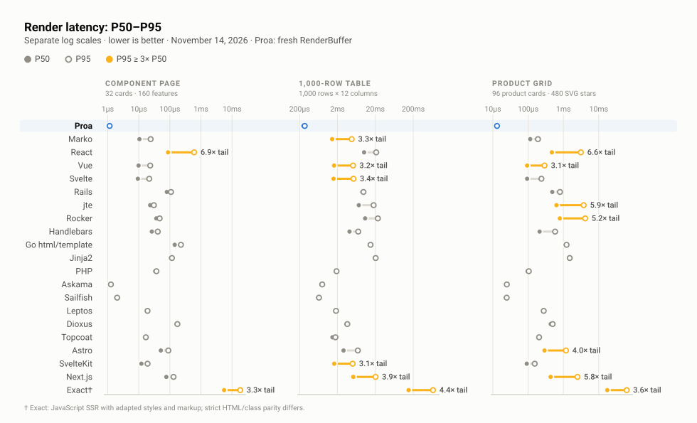

# Canonical scoreboard evidence

Seventeen renderers turn the same prepared data into the same three pages, and the scoreboard times only that render. This page holds the [current result](#current-result), the [renderer coverage](#renderer-coverage), and the [complete canonical evidence](#complete-canonical-evidence) behind the [front page](../../README.md)'s figures.

## Current result

<!-- canonical-scoreboard:start -->

**November 14, 2026 · Intel(R) Xeon(R) 6985P-C CPU @ 2.30GHz · linux**

On these workloads, the November 14, 2026 capture on Intel(R) Xeon(R) 6985P-C CPU @ 2.30GHz measured Proa rendering the component page 78.4× faster than React, the 1,000-row table 39.9× faster than React, and the product grid 36.9× faster than React. These ratios describe this capture, not every application.

> Lower is better. Strict rows pass unchanged DOM/class parity. Exact† uses an explicitly adapted fixture with equivalent content and native styles; its HTML differs. See [adaptation details](../../benchmarks/rendering/external/exact/README.md).

Each cell is `P50 render time · relative to Proa`.

| Renderer | Component page | 1,000-row table | Product grid |
| --- | ---: | ---: | ---: |
| Proa | 0.001 ms · 1.00× | 0.25 ms · 1.00× | 0.013 ms · 1.00× |
| Marko | 0.011 ms · 9.42× | 1.45 ms · 5.72× | 0.11 ms · 8.97× |
| React | 0.087 ms · 78.4× | 10.1 ms · 39.9× | 0.47 ms · 36.9× |
| Vue | 0.010 ms · 8.83× | 1.62 ms · 6.42× | 0.094 ms · 7.34× |
| Svelte | 0.009 ms · 8.38× | 1.58 ms · 6.24× | 0.094 ms · 7.35× |
| Rails | 0.080 ms · 71.6× | 9.10 ms · 35.9× | 0.48 ms · 37.9× |
| jte | 0.023 ms · 20.8× | 7.32 ms · 28.9× | 0.64 ms · 49.9× |
| Rocker | 0.037 ms · 32.8× | 10.8 ms · 42.5× | 0.79 ms · 62.1× |
| Handlebars | 0.026 ms · 23.5× | 4.16 ms · 16.4× | 0.21 ms · 16.6× |
| Go html/template | 0.14 ms · 128× | 14.4 ms · 56.7× | 1.17 ms · 91.6× |
| Jinja2 | 0.11 ms · 97.9× | 19.3 ms · 76.2× | 1.48 ms · 116× |
| PHP | 0.034 ms · 30.4× | 1.84 ms · 7.26× | 0.096 ms · 7.57× |
| Askama | 0.001 ms · 1.12× | 0.76 ms · 3.00× | 0.024 ms · 1.91× |
| Sailfish | 0.002 ms · 1.73× | 0.63 ms · 2.48× | 0.024 ms · 1.85× |
| Leptos | 0.019 ms · 16.7× | 1.79 ms · 7.08× | 0.27 ms · 21.2× |
| Dioxus | 0.17 ms · 148× | 3.47 ms · 13.7× | 0.44 ms · 34.2× |
| Topcoat | 0.016 ms · 14.7× | 1.48 ms · 5.83× | 0.20 ms · 15.5× |
| Astro | 0.051 ms · 46.0× | 2.90 ms · 11.4× | 0.29 ms · 22.8× |
| SvelteKit | 0.012 ms · 10.9× | 1.64 ms · 6.48× | 0.091 ms · 7.17× |
| Next.js | 0.077 ms · 68.9× | 5.24 ms · 20.7× | 0.43 ms · 33.9× |
| Exact† | 5.55 ms · 4977× | 151 ms · 597× | 17.5 ms · 1372× |

Rows use the fixed order in [the canonical roster](../../benchmarks/rendering/canonical/roster.json); columns are never ranked independently.
<!-- canonical-scoreboard:end -->

### How to read the scoreboard

- **Two kinds of renderer share the table.** Proa, React, Vue, Svelte, Marko, Leptos, Dioxus, and Topcoat are component frameworks with a component model and, in most cases, streaming and client interactivity. Askama, Sailfish, jte, Rocker, Handlebars, Go `html/template`, Jinja2, PHP, and Rails Action View are template engines. In the PROA-only refresh, Proa has the lowest P50 on all three workloads, including against the retained Askama and Sailfish rows. Peer results retain their original capture date.
- **Contrary cells stay.** The refreshed Proa row leads Askama and Sailfish on all three P50s; their original measurements remain in the table. Both emit a 44,849-byte component page against Proa's 25,108 bytes because their templates keep authored whitespace. The semantic DOM is identical, and the byte counts are in the detailed table.
- **Ratios are per capture.** The multiples describe this machine and these three pages. The [HTTP captures](http-capacity.md) translate them into per-core capacity, which is the portable number.

### The three workloads

| Workload | Fixed shape |
| --- | --- |
| Component page | 4 sections, 32 cards, and 160 feature-list items |
| 1,000-row table | 12 columns with escaping, formatting, branches, and variable-length lists |
| Product grid | 96 product cards and 480 SVG stars |

The same deterministic input objects feed every adapter, and input and template construction happen before timing.

### Fairness rules

- Each listed renderer implements all three workloads and uses one pinned canonical runtime.
- Production or release builds return one complete, independently owned response per measured render.
- Routing, middleware, databases, HTTP transfer, hydration, and network latency are outside the scoreboard measurement; the HTTP sections state what they add back.
- Every adapter must pass the shared browser-DOM parity gate before any timing starts.
- Serializer metadata may differ where unavoidable; the detailed report records payload differences and exact-byte matches.

### Reading the adapters

Each renderer's page is real code in this repository, written the way its documentation recommends. Judge fairness by reading the product-grid implementations side by side:

| Renderer | Product grid source | HTTP server |
| --- | --- | --- |
| Proa | [`benchmarks/rendering/src/topcoat_product_grid.rs`](../../benchmarks/rendering/src/topcoat_product_grid.rs) | [`benchmarks/rendering/src/bin/proa_page_server.rs`](../../benchmarks/rendering/src/bin/proa_page_server.rs) |
| React | [`benchmarks/rendering/external/react/suite_components.mjs`](../../benchmarks/rendering/external/react/suite_components.mjs) | [`benchmarks/http/react_server.mjs`](../../benchmarks/http/react_server.mjs) |
| Marko | [`benchmarks/rendering/external/marko/suite_products.marko`](../../benchmarks/rendering/external/marko/suite_products.marko) | [`benchmarks/rendering/external/marko/page_server.mjs`](../../benchmarks/rendering/external/marko/page_server.mjs) |
| Go html/template | [`benchmarks/rendering/external/go/suite_bench.go`](../../benchmarks/rendering/external/go/suite_bench.go) | same file, `--serve` |
| Rails, jte, Rocker, Handlebars, Jinja2, PHP | [`benchmarks/rendering/external/`](../../benchmarks/rendering/external/) | scoreboard only |
| Askama, Sailfish, Leptos, Dioxus, Topcoat | [`benchmarks/rendering/src/`](../../benchmarks/rendering/src/) | scoreboard only |

The Proa product card is an ordinary typed component, and the React card is the same markup as `createElement` calls. Both are what a team would write, and both produce the same DOM:

```rust filename="benchmarks/rendering/src/topcoat_product_grid.rs"
impl<B: WriteBuf, L: DataLoader> WebRenderSync<L, B> for ProaProductCard<'_> {
    fn render(self, cx: &mut WebContext<L, B>) -> Result<(), WriteError> {
        let product = self.product;
        html_sync! {
            <a href={ProductUrl(product.id)} class="group flex flex-col rounded-xl border border-slate-200 bg-white p-4 shadow-sm transition hover:shadow-md">
                <div class="mb-4 flex h-32 items-center justify-center rounded-lg bg-slate-100 text-3xl font-bold text-slate-300">{text(&product.category)}</div>
                <p class="text-xs font-medium uppercase tracking-wide text-slate-400">{text(&product.category)}</p>
                <h3 class="mt-1 text-sm font-semibold text-slate-900 group-hover:text-indigo-600">{text(&product.name)}</h3>
                <div class="mt-2 flex items-center gap-1">
                    {ProaRatingStars(product.rating_tenths)}
                    <span class="text-xs text-slate-500">{Rating(product.rating_tenths)}" ("{product.review_count}")"</span>
                </div>
                <p class="mt-3 text-lg font-bold">{Price(product.price_cents)}</p>
            </a>
        }
        .render(cx)
    }
}
```

[Renderer coverage](#renderer-coverage) records which renderers are in the roster and which cells passed.

## Renderer coverage

<!-- canonical-coverage:start -->
| Renderer | Status | Detail |
| --- | --- | --- |
| Proa | Included | All 3 workloads passed parity in this capture. |
| Marko | Included | All 3 workloads passed parity in this capture. |
| React | Included | All 3 workloads passed parity in this capture. |
| Vue | Included | All 3 workloads passed parity in this capture. |
| Svelte | Included | All 3 workloads passed parity in this capture. |
| Rails | Included | All 3 workloads passed parity in this capture. |
| jte | Included | All 3 workloads passed parity in this capture. |
| Rocker | Included | All 3 workloads passed parity in this capture. |
| Handlebars | Included | All 3 workloads passed parity in this capture. |
| Go html/template | Included | All 3 workloads passed parity in this capture. |
| Jinja2 | Included | All 3 workloads passed parity in this capture. |
| PHP | Included | All 3 workloads passed parity in this capture. |
| Askama | Included | All 3 workloads passed parity in this capture. |
| Sailfish | Included | All 3 workloads passed parity in this capture. |
| Leptos | Included | All 3 workloads passed parity in this capture. |
| Dioxus | Included | All 3 workloads passed parity in this capture. |
| Topcoat | Included | All 3 workloads passed parity in this capture. |
| Astro | Included | All 3 workloads passed parity in this capture. |
| SvelteKit | Included | All 3 workloads passed parity in this capture. |
| Next.js | Included | All 3 workloads passed parity in this capture. |
| Exact | Included | All 3 adapted workloads passed content and style checks; HTML differs. See the Exact adaptation notes. |
<!-- canonical-coverage:end -->

Every retained percentile, payload, digest, version, and limitation follows in [Complete canonical evidence](#complete-canonical-evidence).

## Complete canonical evidence

The scoreboard's own result JSON generates this section.

[](../figures/02-canonical-tail-dispersion.svg)

*Median against tail. A long bar is an unstable renderer, not a slow one; Marko's 1,000-row table is the capture's single flagged cell at 14.5× its own median. Drawn from [Detailed measurements](#detailed-measurements) · [Full size](../figures/02-canonical-tail-dispersion.svg) · [how the figures are built](../../tooling/charts/)*

<!-- canonical-details:start -->
### Capture metadata

- Capture: `canonical-ssr-v1-2026-11-14T04-25-12-136Z-32700929`
- Captured: 2026-11-14T04:25:12.136Z
- Completed: 2026-11-14T04:36:08.618Z
- Host: Intel(R) Xeon(R) 6985P-C CPU @ 2.30GHz, 16 logical CPUs, 63200751616 bytes RAM
- OS: linux (6.12.105+), x64
- Proa output: Fresh owned RenderBuffer per iteration. Allocation and rendering are timed; flattening/copying, encoding, parity, hashing and output destruction are outside the render timer.
- Harness commit: `db57c694b8a9f35be288bc5ac6cd1a4bf83a0e33`
- Canonical source SHA-256: `8e3f6c791501becbcf394f3302def4bea9a27e31fb9da23ec0b496d4f7d548c1`

### Detailed measurements

| Renderer | Workload | P50 | P95 | P99 | Mean | Process P50 range | Processes | Samples/process | Warmups/process | Payload bytes | Payload Δ vs Proa | Parity |
| --- | --- | ---: | ---: | ---: | ---: | ---: | ---: | ---: | ---: | ---: | ---: | --- |
| Proa | Component page | 1.116 µs | 1.155 µs | 1.182 µs | 1.139 µs | 1.104 µs–1.128 µs | 5 | 2000 | 200 | 25,108 | +0 | semantic DOM pass |
| Proa | 1,000-row table | 253.222 µs | 273.419 µs | 283.216 µs | 254.984 µs | 246.069 µs–256.260 µs | 5 | 200 | 20 | 988,509 | +0 | semantic DOM pass |
| Proa | Product grid | 12.752 µs | 13.104 µs | 18.561 µs | 12.944 µs | 12.601 µs–13.145 µs | 5 | 500 | 50 | 284,908 | +0 | semantic DOM pass |
| Marko | Component page | 10.513 µs | 24.139 µs | 36.230 µs | 26.474 µs | 10.344 µs–10.659 µs | 5 | 2000 | 200 | 24,038 | -1,070 | semantic DOM pass |
| Marko | 1,000-row table | 1.448 ms | 4.760 ms | 7.451 ms | 2.019 ms | 1.378 ms–1.514 ms | 5 | 200 | 20 | 983,187 | -5,322 | semantic DOM pass |
| Marko | Product grid | 114.436 µs | 190.125 µs | 3.161 ms | 201.795 µs | 107.753 µs–119.689 µs | 5 | 500 | 50 | 282,604 | -2,304 | semantic DOM pass |
| React | Component page | 87.456 µs | 603.889 µs | 3.171 ms | 221.572 µs | 83.186 µs–94.308 µs | 5 | 2000 | 200 | 25,202 | +94 | semantic DOM pass |
| React | 1,000-row table | 10.103 ms | 21.082 ms | 34.428 ms | 10.688 ms | 9.146 ms–10.882 ms | 5 | 200 | 20 | 990,695 | +2,186 | semantic DOM pass |
| React | Product grid | 470.215 µs | 3.120 ms | 10.417 ms | 1.195 ms | 436.243 µs–511.958 µs | 5 | 500 | 50 | 285,868 | +960 | semantic DOM pass |
| Vue | Component page | 9.854 µs | 23.375 µs | 40.419 µs | 37.375 µs | 9.611 µs–10.527 µs | 5 | 2000 | 200 | 25,700 | +592 | semantic DOM pass |
| Vue | 1,000-row table | 1.625 ms | 5.162 ms | 7.596 ms | 2.443 ms | 1.606 ms–1.653 ms | 5 | 200 | 20 | 1,006,523 | +18,014 | semantic DOM pass |
| Vue | Product grid | 93.600 µs | 291.249 µs | 5.250 ms | 279.389 µs | 93.382 µs–103.656 µs | 5 | 500 | 50 | 287,420 | +2,512 | semantic DOM pass |
| Svelte | Component page | 9.350 µs | 21.736 µs | 46.798 µs | 26.873 µs | 9.026 µs–9.888 µs | 5 | 2000 | 200 | 25,748 | +640 | semantic DOM pass |
| Svelte | 1,000-row table | 1.579 ms | 5.294 ms | 7.266 ms | 2.454 ms | 1.429 ms–1.713 ms | 5 | 200 | 20 | 1,003,227 | +14,718 | semantic DOM pass |
| Svelte | Product grid | 93.745 µs | 238.237 µs | 3.129 ms | 218.250 µs | 91.448 µs–104.490 µs | 5 | 500 | 50 | 286,476 | +1,568 | semantic DOM pass |
| Rails | Component page | 79.928 µs | 108.948 µs | 534.581 µs | 93.618 µs | 79.540 µs–80.749 µs | 5 | 2000 | 200 | 35,839 | +10,731 | semantic DOM pass |
| Rails | 1,000-row table | 9.101 ms | 9.724 ms | 9.830 ms | 9.004 ms | 8.902 ms–9.128 ms | 5 | 200 | 20 | 1,228,793 | +240,284 | semantic DOM pass |
| Rails | Product grid | 483.340 µs | 799.155 µs | 2.341 ms | 562.655 µs | 453.676 µs–585.342 µs | 5 | 500 | 50 | 296,823 | +11,915 | semantic DOM pass |
| jte | Component page | 23.259 µs | 30.617 µs | 528.977 µs | 54.649 µs | 15.401 µs–23.602 µs | 5 | 2000 | 200 | 25,109 | +1 | semantic DOM pass |
| jte | 1,000-row table | 7.320 ms | 18.014 ms | 27.260 ms | 8.960 ms | 6.926 ms–7.409 ms | 5 | 200 | 20 | 988,510 | +1 | semantic DOM pass |
| jte | Product grid | 636.497 µs | 3.753 ms | 4.538 ms | 1.255 ms | 626.455 µs–646.404 µs | 5 | 500 | 50 | 284,909 | +1 | semantic DOM pass |
| Rocker | Component page | 36.642 µs | 46.982 µs | 3.008 ms | 77.100 µs | 36.453 µs–37.126 µs | 5 | 2000 | 200 | 25,109 | +1 | semantic DOM pass |
| Rocker | 1,000-row table | 10.766 ms | 23.322 ms | 36.981 ms | 11.184 ms | 9.594 ms–10.983 ms | 5 | 200 | 20 | 990,508 | +1,999 | semantic DOM pass |
| Rocker | Product grid | 791.409 µs | 4.141 ms | 4.850 ms | 1.650 ms | 715.899 µs–812.851 µs | 5 | 500 | 50 | 285,869 | +961 | semantic DOM pass |
| Handlebars | Component page | 26.260 µs | 40.856 µs | 168.462 µs | 50.634 µs | 22.612 µs–33.463 µs | 5 | 2000 | 200 | 25,108 | +0 | semantic DOM pass |
| Handlebars | 1,000-row table | 4.161 ms | 7.071 ms | 15.100 ms | 4.888 ms | 4.080 ms–4.844 ms | 5 | 200 | 20 | 990,694 | +2,185 | semantic DOM pass |
| Handlebars | Product grid | 211.170 µs | 581.619 µs | 3.476 ms | 424.506 µs | 207.108 µs–266.276 µs | 5 | 500 | 50 | 285,868 | +960 | semantic DOM pass |
| Go html/template | Component page | 143.317 µs | 227.024 µs | 237.068 µs | 163.395 µs | 142.337 µs–145.026 µs | 5 | 2000 | 200 | 25,108 | +0 | semantic DOM pass |
| Go html/template | 1,000-row table | 14.370 ms | 14.933 ms | 15.561 ms | 14.390 ms | 14.138 ms–14.667 ms | 5 | 200 | 20 | 990,509 | +2,000 | semantic DOM pass |
| Go html/template | Product grid | 1.168 ms | 1.227 ms | 1.331 ms | 1.175 ms | 1.148 ms–1.176 ms | 5 | 500 | 50 | 285,676 | +768 | semantic DOM pass |
| Jinja2 | Component page | 109.252 µs | 116.607 µs | 121.136 µs | 109.660 µs | 107.503 µs–109.895 µs | 5 | 2000 | 200 | 25,108 | +0 | semantic DOM pass |
| Jinja2 | 1,000-row table | 19.284 ms | 20.397 ms | 23.555 ms | 19.477 ms | 19.017 ms–20.291 ms | 5 | 200 | 20 | 990,257 | +1,748 | semantic DOM pass |
| Jinja2 | Product grid | 1.476 ms | 1.510 ms | 1.536 ms | 1.476 ms | 1.423 ms–1.492 ms | 5 | 500 | 50 | 285,676 | +768 | semantic DOM pass |
| PHP | Component page | 33.873 µs | 37.015 µs | 41.543 µs | 34.276 µs | 33.317 µs–34.285 µs | 5 | 2000 | 200 | 25,108 | +0 | semantic DOM pass |
| PHP | 1,000-row table | 1.838 ms | 1.891 ms | 1.912 ms | 1.841 ms | 1.766 ms–1.847 ms | 5 | 200 | 20 | 990,694 | +2,185 | semantic DOM pass |
| PHP | Product grid | 96.486 µs | 104.420 µs | 107.615 µs | 98.278 µs | 93.565 µs–100.383 µs | 5 | 500 | 50 | 285,868 | +960 | semantic DOM pass |
| Askama | Component page | 1.247 µs | 1.270 µs | 1.296 µs | 1.262 µs | 1.221 µs–1.291 µs | 5 | 2000 | 200 | 44,849 | +19,741 | semantic DOM pass |
| Askama | 1,000-row table | 760.736 µs | 792.746 µs | 806.908 µs | 763.992 µs | 753.691 µs–774.031 µs | 5 | 200 | 20 | 991,007 | +2,498 | semantic DOM pass |
| Askama | Product grid | 24.299 µs | 24.858 µs | 31.170 µs | 24.661 µs | 23.709 µs–24.471 µs | 5 | 500 | 50 | 285,676 | +768 | semantic DOM pass |
| Sailfish | Component page | 1.926 µs | 2.020 µs | 2.119 µs | 1.955 µs | 1.913 µs–1.987 µs | 5 | 2000 | 200 | 44,849 | +19,741 | semantic DOM pass |
| Sailfish | 1,000-row table | 627.548 µs | 650.846 µs | 673.457 µs | 629.553 µs | 614.043 µs–630.584 µs | 5 | 200 | 20 | 990,694 | +2,185 | semantic DOM pass |
| Sailfish | Product grid | 23.559 µs | 24.686 µs | 30.578 µs | 23.820 µs | 23.110 µs–24.037 µs | 5 | 500 | 50 | 285,868 | +960 | semantic DOM pass |
| Leptos | Component page | 18.668 µs | 19.156 µs | 24.702 µs | 18.850 µs | 18.602 µs–19.607 µs | 5 | 2000 | 200 | 25,219 | +111 | semantic DOM pass |
| Leptos | 1,000-row table | 1.792 ms | 1.830 ms | 1.851 ms | 1.792 ms | 1.762 ms–1.807 ms | 5 | 200 | 20 | 991,512 | +3,003 | semantic DOM pass |
| Leptos | Product grid | 270.070 µs | 276.619 µs | 282.291 µs | 271.001 µs | 264.764 µs–270.308 µs | 5 | 500 | 50 | 286,063 | +1,155 | semantic DOM pass |
| Dioxus | Component page | 165.105 µs | 174.800 µs | 177.851 µs | 165.627 µs | 160.392 µs–166.608 µs | 5 | 2000 | 200 | 25,141 | +33 | semantic DOM pass |
| Dioxus | 1,000-row table | 3.473 ms | 3.642 ms | 3.660 ms | 3.458 ms | 3.402 ms–3.745 ms | 5 | 200 | 20 | 990,695 | +2,186 | semantic DOM pass |
| Dioxus | Product grid | 436.108 µs | 494.974 µs | 501.436 µs | 447.264 µs | 413.336 µs–471.721 µs | 5 | 500 | 50 | 285,868 | +960 | semantic DOM pass |
| Topcoat | Component page | 16.357 µs | 16.890 µs | 21.878 µs | 16.272 µs | 16.021 µs–16.393 µs | 5 | 2000 | 200 | 25,108 | +0 | semantic DOM pass |
| Topcoat | 1,000-row table | 1.476 ms | 1.771 ms | 1.783 ms | 1.556 ms | 1.444 ms–1.488 ms | 5 | 200 | 20 | 988,509 | +0 | semantic DOM pass |
| Topcoat | Product grid | 197.558 µs | 204.629 µs | 210.293 µs | 198.656 µs | 192.000 µs–198.023 µs | 5 | 500 | 50 | 284,908 | +0 | semantic DOM pass |
| Astro | Component page | 51.290 µs | 89.267 µs | 878.230 µs | 114.134 µs | 50.150 µs–53.108 µs | 5 | 2000 | 200 | 25,108 | +0 | semantic DOM pass |
| Astro | 1,000-row table | 2.897 ms | 6.906 ms | 9.917 ms | 3.765 ms | 2.754 ms–3.090 ms | 5 | 200 | 20 | 990,507 | +1,998 | semantic DOM pass |
| Astro | Product grid | 291.138 µs | 1.179 ms | 3.503 ms | 542.165 µs | 288.668 µs–293.988 µs | 5 | 500 | 50 | 285,868 | +960 | semantic DOM pass |
| SvelteKit | Component page | 12.168 µs | 19.180 µs | 30.925 µs | 30.680 µs | 11.284 µs–12.442 µs | 5 | 2000 | 200 | 25,770 | +662 | semantic DOM pass |
| SvelteKit | 1,000-row table | 1.640 ms | 5.040 ms | 8.021 ms | 2.574 ms | 1.588 ms–1.691 ms | 5 | 200 | 20 | 1,003,248 | +14,739 | semantic DOM pass |
| SvelteKit | Product grid | 91.400 µs | 153.940 µs | 3.442 ms | 219.261 µs | 89.600 µs–94.805 µs | 5 | 500 | 50 | 286,476 | +1,568 | semantic DOM pass |
| Next.js | Component page | 76.861 µs | 131.256 µs | 1.490 ms | 157.049 µs | 75.949 µs–80.987 µs | 5 | 2000 | 200 | 25,201 | +93 | semantic DOM pass |
| Next.js | 1,000-row table | 5.235 ms | 20.271 ms | 32.860 ms | 8.251 ms | 5.108 ms–5.562 ms | 5 | 200 | 20 | 990,694 | +2,185 | semantic DOM pass |
| Next.js | Product grid | 432.763 µs | 2.507 ms | 4.987 ms | 826.971 µs | 415.702 µs–436.120 µs | 5 | 500 | 50 | 285,868 | +960 | semantic DOM pass |
| Exact | Component page | 5.555 ms | 18.299 ms | 30.084 ms | 7.436 ms | 5.541 ms–5.610 ms | 5 | 2000 | 200 | 34,637 | +9,529 | adapted content and styles pass |
| Exact | 1,000-row table | 151.112 ms | 665.560 ms | 912.530 ms | 238.520 ms | 145.569 ms–151.713 ms | 5 | 200 | 20 | 1,025,844 | +37,335 | adapted content and styles pass |
| Exact | Product grid | 17.499 ms | 62.255 ms | 92.318 ms | 23.159 ms | 17.319 ms–17.594 ms | 5 | 500 | 50 | 261,879 | -23,029 | adapted content and styles pass |

### Tail observations

The report flags every cell whose process-median P95 is at least 3× its P50:

- Marko's 1,000-row table P95 was 3.29× its P50 (4.760 ms versus 1.448 ms).
- React's component page P95 was 6.91× its P50 (603.889 µs versus 87.456 µs).
- React's product grid P95 was 6.63× its P50 (3.120 ms versus 470.215 µs).
- Vue's 1,000-row table P95 was 3.18× its P50 (5.162 ms versus 1.625 ms).
- Vue's product grid P95 was 3.11× its P50 (291.249 µs versus 93.600 µs).
- Svelte's 1,000-row table P95 was 3.35× its P50 (5.294 ms versus 1.579 ms).
- jte's product grid P95 was 5.90× its P50 (3.753 ms versus 636.497 µs).
- Rocker's product grid P95 was 5.23× its P50 (4.141 ms versus 791.409 µs).
- Astro's product grid P95 was 4.05× its P50 (1.179 ms versus 291.138 µs).
- SvelteKit's 1,000-row table P95 was 3.07× its P50 (5.040 ms versus 1.640 ms).
- Next.js's 1,000-row table P95 was 3.87× its P50 (20.271 ms versus 5.235 ms).
- Next.js's product grid P95 was 5.79× its P50 (2.507 ms versus 432.763 µs).
- Exact's component page P95 was 3.29× its P50 (18.299 ms versus 5.555 ms).
- Exact's 1,000-row table P95 was 4.40× its P50 (665.560 ms versus 151.112 ms).
- Exact's product grid P95 was 3.56× its P50 (62.255 ms versus 17.499 ms).

### Parity

Chromium parses every untimed dump. The gate requires identical elements, non-class attributes, class membership, visible text, and body order. It ignores renderer-internal comments, resource-preload hints, non-semantic `<head>` order, class-token order, and adjacent hydration-split text nodes. The timed response is never normalized.

| Workload | Canonical DOM SHA-256 | Exact-byte matches |
| --- | --- | ---: |
| Component page | `43c50a97024231d49639400a5bfb18df7dbe5e94068cd42a732cea26ed0188b4` | 7/21 |
| 1,000-row table | `ba9bb6481cefab9898ff8c7d6c31405f3379c3ddaede2690e5c70ef46473356b` | 2/21 |
| Product grid | `5c89ccf8708043183838767b4bf61a68d9afc8bbf78830dc8886a851be162cfe` | 2/21 |

### Renderer and runtime versions

| Renderer/runtime | Version |
| --- | --- |
| Proa | 0.4.0 @ ceffd9f305acabbb0584fa181df4f4e2d7883e94 / rustc 1.95.0 (59807616e 2026-04-14) |
| Marko | 6.0.150 / Bun 1.4.2 |
| React | 19.2.4 / Bun 1.4.2 |
| Vue | 3.5.42 / Bun 1.4.2 |
| Svelte | 5.57.2 / Bun 1.4.2 |
| Rails | Rails 8.1.3.1 / ruby 4.0.6 (2026-07-14 revision 03b6d3f889) +PRISM [x86_64-linux] |
| jte | 3.2.4 / openjdk 17.0.21.0.3 2026-10-24 |
| Rocker | 2.4.0 / openjdk 17.0.21.0.3 2026-10-24 |
| Handlebars | 4.7.8 / Bun 1.4.2 |
| Go html/template | go version go1.25.5 linux/amd64 |
| Jinja2 | 3.1.6 / Python 3.13.18 |
| PHP | PHP 8.3.6 (cli) (built: Oct 19 2026 15:16:58) (NTS) |
| Askama | 0.15.6 / rustc 1.95.0 (59807616e 2026-04-14) |
| Sailfish | 0.10.2 / rustc 1.95.0 (59807616e 2026-04-14) |
| Leptos | 0.7.8 / rustc 1.95.0 (59807616e 2026-04-14) |
| Dioxus | 0.6.3 + dioxus-ssr 0.6.2 / rustc 1.95.0 (59807616e 2026-04-14) |
| Topcoat | 0.3.1 / rustc 1.95.0 (59807616e 2026-04-14) |
| Playwright | 1.61.1 |
| Chromium | 149.0.7827.55 |
| Astro | 7.4.8 |
| SvelteKit | 3.1.0 |
| Next.js | Next.js 16.4.6 compiled page / bundled React DOM 19.3.0-canary-278794d7-20261002 / Bun 1.4.2 |
| Exact | 94b8671f70fe2e25b307a40e7fce66dc27c9f802 |

### Reproduction

```sh
./benchmarks/rendering/run-all
```

The runner builds every fixed-roster adapter, runs the complete parity matrix, stops before timing if any cell fails, rotates renderer process order, records per-process summaries, writes `latest.json`, and generates this report and the README tables.

Full commands recorded by the capture:

- `bun install --frozen-lockfile (repository root, all JavaScript workspaces)`
- `bundle check || bundle install (Rails adapter directory)`
- `cargo build --locked --release -p proa_bench --features topcoat --bin representative_suite_bench`
- `go build -trimpath -o rendering/external/go/build/canonical_suite rendering/external/go/suite_bench.go`
- `python3 -m venv rendering/external/jinja/.venv && pip install -r rendering/external/jinja/requirements.txt`
- `gradle --no-daemon --quiet installDist copyJteBinaryStaticContent (jte adapter directory)`
- `gradle --no-daemon --quiet installDist (Rocker adapter directory)`
- `"bun" "rendering/canonical/run.mjs" "--no-setup"`

### Known limitations

- Renderer-only latency excludes routing, middleware, databases, HTTP transfer, hydration, and network latency.
- Semantic DOM parity permits documented serializer metadata and whitespace differences; payload deltas remain visible.
- This capture describes one machine and these three workloads; it is not a universal application ranking.
- Exact uses the disclosed exact-native-v1 adaptation: named native styles, generated classes, text/list wrappers and separated table borders. Content, attributes, formatting and representative computed CSS are checked separately; strict DOM parity is not claimed. Fresh per-render VM/runtime initialization, prepared-input binding, DOM construction and HTML serialization are inside timing; source compilation and input-data construction are outside.

### Raw and related evidence

- [Per-process summaries](../../benchmarks/rendering/results/raw/canonical-ssr-v1-2026-11-14T04-25-12-136Z-32700929/process-summaries.json)
- [Result-table migration map](../../benchmarks/rendering/MIGRATION.md)
- [Exact adapted cards stylesheet](../../benchmarks/rendering/results/raw/canonical-ssr-v1-2026-11-14T04-25-12-136Z-32700929/cards-exact.css)
- [Exact adapted table stylesheet](../../benchmarks/rendering/results/raw/canonical-ssr-v1-2026-11-14T04-25-12-136Z-32700929/table-exact.css)
- [Exact adapted products stylesheet](../../benchmarks/rendering/results/raw/canonical-ssr-v1-2026-11-14T04-25-12-136Z-32700929/products-exact.css)
- [Unchanged fixture admission checks](../../benchmarks/rendering/results/raw/canonical-ssr-v1-2026-11-14T04-25-12-136Z-32700929/admissions.json)

Allocation measurements and construction-path controls remain separate from this renderer scoreboard. See the [engineering report](engineering.md) and [mechanism-specific notes](../engineering/README.md).

<!-- canonical-details:end -->

## Next steps

- [Front page](../../README.md)
  - The four figures and the reasons to trust them.
- [HTTP capacity, cold start and streaming](http-capacity.md)
  - What one core of each production server sustains, and what a fresh process costs.
- [Engineering, application and agent captures](engineering.md)
  - Product-grid scaling, the memcpy floor, Proa's buffer allocation, and the archived August report.
- [Canonical benchmark protocol](../../benchmarks/rendering/protocol.md)
  - The parity gate, the fairness rules, and the workload shapes in full.
- [Rendering suite](../../benchmarks/rendering/)
  - The adapters, the runner, and the engineering laboratory behind the scoreboard.
