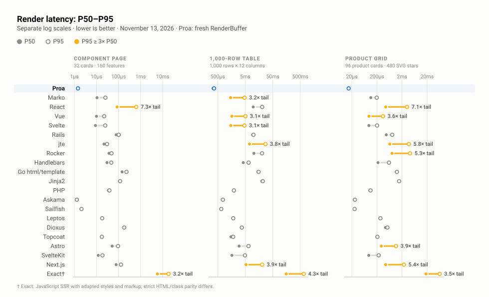

# Canonical scoreboard evidence

Seventeen renderers turn the same prepared data into the same three pages, and the scoreboard times only that render. This page holds the [current result](#current-result), the [renderer coverage](#renderer-coverage), and the [complete canonical evidence](#complete-canonical-evidence) behind the [front page](README.md)'s figures.

## Current result

<!-- canonical-scoreboard:start -->

> **PROA-only refresh.** Only Proa was rerun on 2026-11-11; every peer retains its 2026-10-21 measurement and version. These are different capture dates on the same machine. Proa returns a fresh owned RenderBuffer; its page-to-String conversion is excluded. Peer outputs and timings are unchanged.

**November 11, 2026 · Apple M4 Max · macOS (Darwin)**

On these workloads, the November 11, 2026 capture on Apple M4 Max measured Proa rendering the component page 83.0× faster than React, the 1,000-row table 19.2× faster than React, and the product grid 38.5× faster than React. These ratios describe this capture, not every application.

> Lower is better. Every listed renderer produced an equivalent page and passed the parity gate.

Each cell is `P50 render time · relative to Proa`.

| Renderer | Component page | 1,000-row table | Product grid |
| --- | ---: | ---: | ---: |
| Proa | 0.88 µs · 1.00× | 0.19 ms · 1.00× | 0.011 ms · 1.00× |
| Marko | 7.67 µs · 8.76× | 0.95 ms · 5.02× | 0.088 ms · 8.38× |
| React | 72.7 µs · 83.0× | 3.64 ms · 19.2× | 0.40 ms · 38.5× |
| Vue | 7.08 µs · 8.09× | 1.15 ms · 6.07× | 0.083 ms · 7.93× |
| Svelte | 8.21 µs · 9.38× | 0.95 ms · 4.99× | 0.070 ms · 6.71× |
| Rails | 59.0 µs · 67.4× | 6.09 ms · 32.2× | 0.41 ms · 38.7× |
| jte | 8.46 µs · 9.67× | 1.98 ms · 10.4× | 0.23 ms · 21.9× |
| Rocker | 16.0 µs · 18.2× | 2.59 ms · 13.7× | 0.36 ms · 34.6× |
| Handlebars | 19.3 µs · 22.1× | 2.31 ms · 12.2× | 0.20 ms · 19.4× |
| Go html/template | 86.3 µs · 98.6× | 8.61 ms · 45.5× | 0.67 ms · 63.5× |
| Jinja2 | 94.8 µs · 108× | 15.2 ms · 80.1× | 1.30 ms · 124× |
| PHP | 34.0 µs · 38.9× | 1.39 ms · 7.36× | 0.085 ms · 8.05× |
| Askama | 1.54 µs · 1.76× | 0.60 ms · 3.15× | 0.022 ms · 2.14× |
| Sailfish | 2.33 µs · 2.67× | 0.54 ms · 2.85× | 0.025 ms · 2.35× |
| Leptos | 21.5 µs · 24.6× | 1.84 ms · 9.74× | 0.22 ms · 20.6× |
| Dioxus | 105 µs · 120× | 2.27 ms · 12.0× | 0.31 ms · 29.2× |
| Topcoat | 12.1 µs · 13.9× | 1.06 ms · 5.57× | 0.15 ms · 14.4× |

Rows use the fixed order in [the canonical roster](rendering/canonical/roster.json); columns are never ranked independently.
<!-- canonical-scoreboard:end -->

### How to read the scoreboard

- **Two kinds of renderer share the table.** Proa, React, Vue, Svelte, Marko, Leptos, Dioxus, and Topcoat are component frameworks with a component model and, in most cases, streaming and client interactivity. Askama, Sailfish, jte, Rocker, Handlebars, Go `html/template`, Jinja2, PHP, and Rails Action View are template engines. In the PROA-only refresh, Proa has the lowest P50 on all three workloads, including against the retained Askama and Sailfish rows. Peer results retain their original capture date.
- **Contrary cells stay.** The refreshed Proa row leads Askama and Sailfish on all three P50s; their original measurements remain in the table. Both emit a 44,849-byte component page against Proa's 25,108 bytes because their templates keep authored whitespace. The semantic DOM is identical, and the byte counts are in the detailed table.
- **Ratios are per capture.** The multiples describe this machine and these three pages. The [HTTP captures](http-capacity.md) translate them into per-core capacity, which is the portable number.

### The three workloads

| Workload | Fixed shape |
| --- | --- |
| Component page | 4 sections, 32 cards, and 160 feature-list items |
| 1,000-row table | 12 columns with escaping, formatting, branches, and variable-length lists |
| Product grid | 96 product cards and 480 SVG stars |

The same deterministic input objects feed every adapter, and input and template construction happen before timing.

### Fairness rules

- Each listed renderer implements all three workloads and uses one pinned canonical runtime.
- Production or release builds return one complete, independently owned response per measured render.
- Routing, middleware, databases, HTTP transfer, hydration, and network latency are outside the scoreboard measurement; the HTTP sections state what they add back.
- Every adapter must pass the shared browser-DOM parity gate before any timing starts.
- Serializer metadata may differ where unavoidable; the detailed report records payload differences and exact-byte matches.

### Reading the adapters

Each renderer's page is real code in this repository, written the way its documentation recommends. Judge fairness by reading the product-grid implementations side by side:

| Renderer | Product grid source | HTTP server |
| --- | --- | --- |
| Proa | [`rendering/src/topcoat_product_grid.rs`](rendering/src/topcoat_product_grid.rs) | [`rendering/src/bin/proa_page_server.rs`](rendering/src/bin/proa_page_server.rs) |
| React | [`rendering/external/react/suite_components.mjs`](rendering/external/react/suite_components.mjs) | [`page-load/react_server.mjs`](page-load/react_server.mjs) |
| Marko | [`rendering/external/marko/suite_products.marko`](rendering/external/marko/suite_products.marko) | [`rendering/external/marko/page_server.mjs`](rendering/external/marko/page_server.mjs) |
| Go html/template | [`rendering/external/go/suite_bench.go`](rendering/external/go/suite_bench.go) | same file, `--serve` |
| Rails, jte, Rocker, Handlebars, Jinja2, PHP | [`rendering/external/`](rendering/external/) | scoreboard only |
| Askama, Sailfish, Leptos, Dioxus, Topcoat | [`rendering/src/`](rendering/src/) | scoreboard only |

The Proa product card is an ordinary typed component, and the React card is the same markup as `createElement` calls. Both are what a team would write, and both produce the same DOM:

```rust filename="rendering/src/topcoat_product_grid.rs"
impl<B: WriteBuf, L: DataLoader> WebRenderSync<L, B> for ProaProductCard<'_> {
    fn render(self, cx: &mut WebContext<L, B>) -> Result<(), WriteError> {
        let product = self.product;
        html_sync! {
            <a href={ProductUrl(product.id)} class="group flex flex-col rounded-xl border border-slate-200 bg-white p-4 shadow-sm transition hover:shadow-md">
                <div class="mb-4 flex h-32 items-center justify-center rounded-lg bg-slate-100 text-3xl font-bold text-slate-300">{text(&product.category)}</div>
                <p class="text-xs font-medium uppercase tracking-wide text-slate-400">{text(&product.category)}</p>
                <h3 class="mt-1 text-sm font-semibold text-slate-900 group-hover:text-indigo-600">{text(&product.name)}</h3>
                <div class="mt-2 flex items-center gap-1">
                    {ProaRatingStars(product.rating_tenths)}
                    <span class="text-xs text-slate-500">{Rating(product.rating_tenths)}" ("{product.review_count}")"</span>
                </div>
                <p class="mt-3 text-lg font-bold">{Price(product.price_cents)}</p>
            </a>
        }
        .render(cx)
    }
}
```

[Renderer coverage](#renderer-coverage) records which renderers are in the roster and which cells passed.

## Renderer coverage

<!-- canonical-coverage:start -->
| Renderer | Status | Detail |
| --- | --- | --- |
| Proa | Included | All 3 workloads passed parity in this capture. |
| Marko | Included | All 3 workloads passed parity in this capture. |
| React | Included | All 3 workloads passed parity in this capture. |
| Vue | Included | All 3 workloads passed parity in this capture. |
| Svelte | Included | All 3 workloads passed parity in this capture. |
| Rails | Included | All 3 workloads passed parity in this capture. |
| jte | Included | All 3 workloads passed parity in this capture. |
| Rocker | Included | All 3 workloads passed parity in this capture. |
| Handlebars | Included | All 3 workloads passed parity in this capture. |
| Go html/template | Included | All 3 workloads passed parity in this capture. |
| Jinja2 | Included | All 3 workloads passed parity in this capture. |
| PHP | Included | All 3 workloads passed parity in this capture. |
| Askama | Included | All 3 workloads passed parity in this capture. |
| Sailfish | Included | All 3 workloads passed parity in this capture. |
| Leptos | Included | All 3 workloads passed parity in this capture. |
| Dioxus | Included | All 3 workloads passed parity in this capture. |
| Topcoat | Included | All 3 workloads passed parity in this capture. |
<!-- canonical-coverage:end -->

Every retained percentile, payload, digest, version, and limitation follows in [Complete canonical evidence](#complete-canonical-evidence).

## Complete canonical evidence

The scoreboard's own result JSON generates this section.

[](charts/svg/02-canonical-tail-dispersion.svg)

*Median against tail. A long bar is an unstable renderer, not a slow one; Marko's 1,000-row table is the capture's single flagged cell at 14.5× its own median. Drawn from [Detailed measurements](#detailed-measurements) · [Full size](charts/svg/02-canonical-tail-dispersion.svg) · [how the figures are built](charts/)*

<!-- canonical-details:start -->
### Capture metadata

Only Proa was rerun on 2026-11-11; every peer retains its 2026-10-21 measurement and version. These are different capture dates on the same machine. Proa returns a fresh owned RenderBuffer; its page-to-String conversion is excluded. Peer outputs and timings are unchanged.

- Capture: `canonical-ssr-v1-proa-2026-11-11T18-37-55-139Z`
- Captured: 2026-11-11T18:37:55.139Z
- Completed: 2026-11-11T18:37:57.005Z
- Host: Apple M4 Max, 16 logical CPUs, 137438953472 bytes RAM
- OS: macOS (Darwin) (25.5.0), arm64
- Proa output: fresh owned RenderBuffer; no flattening or String conversion
- Harness commit: `461f84da7093d41f1e2332d1b3f8c3702ecafa4c` (dirty; source digest retained)
- Canonical source SHA-256: `75b6b3a8738007f53f34472b068aa20bcbcb7b79266063b0d52a5546a4eb5d56`

### Detailed measurements

| Renderer | Workload | P50 | P95 | P99 | Mean | Process P50 range | Processes | Samples/process | Warmups/process | Payload bytes | Payload Δ vs Proa | Parity |
| --- | --- | ---: | ---: | ---: | ---: | ---: | ---: | ---: | ---: | ---: | ---: | --- |
| Proa | Component page | 0.875 µs | 0.917 µs | 1.000 µs | 0.874 µs | 0.834 µs–0.875 µs | 5 | 2000 | 200 | 25,108 | +0 | semantic DOM pass |
| Proa | 1,000-row table | 189.375 µs | 198.069 µs | 206.739 µs | 187.745 µs | 185.979 µs–190.479 µs | 5 | 200 | 20 | 988,509 | +0 | semantic DOM pass |
| Proa | Product grid | 10.500 µs | 12.000 µs | 13.709 µs | 10.920 µs | 10.333 µs–11.708 µs | 5 | 500 | 50 | 284,908 | +0 | semantic DOM pass |
| Marko | Component page | 7.667 µs | 19.559 µs | 42.218 µs | 14.328 µs | 7.583 µs–8.625 µs | 5 | 2000 | 200 | 24,038 | -1,070 | semantic DOM pass |
| Marko | 1,000-row table | 950.500 µs | 13.576 ms | 21.168 ms | 2.081 ms | 931.854 µs–977.833 µs | 5 | 200 | 20 | 983,187 | -5,322 | semantic DOM pass |
| Marko | Product grid | 87.980 µs | 163.502 µs | 217.315 µs | 148.303 µs | 87.501 µs–94.666 µs | 5 | 500 | 50 | 282,604 | -2,304 | semantic DOM pass |
| React | Component page | 72.666 µs | 101.758 µs | 176.337 µs | 78.189 µs | 72.500 µs–73.916 µs | 5 | 2000 | 200 | 25,202 | +94 | semantic DOM pass |
| React | 1,000-row table | 3.639 ms | 6.419 ms | 7.083 ms | 4.145 ms | 3.561 ms–3.711 ms | 5 | 200 | 20 | 990,695 | +2,186 | semantic DOM pass |
| React | Product grid | 404.250 µs | 841.931 µs | 952.251 µs | 445.657 µs | 398.354 µs–412.313 µs | 5 | 500 | 50 | 285,868 | +960 | semantic DOM pass |
| Vue | Component page | 7.083 µs | 11.961 µs | 25.630 µs | 10.167 µs | 7.021 µs–7.875 µs | 5 | 2000 | 200 | 25,700 | +592 | semantic DOM pass |
| Vue | 1,000-row table | 1.149 ms | 2.257 ms | 2.563 ms | 1.282 ms | 1.139 ms–1.152 ms | 5 | 200 | 20 | 1,006,523 | +18,014 | semantic DOM pass |
| Vue | Product grid | 83.313 µs | 113.711 µs | 267.358 µs | 93.571 µs | 83.145 µs–84.855 µs | 5 | 500 | 50 | 287,420 | +2,512 | semantic DOM pass |
| Svelte | Component page | 8.209 µs | 13.333 µs | 18.416 µs | 9.350 µs | 8.208 µs–8.292 µs | 5 | 2000 | 200 | 25,748 | +640 | semantic DOM pass |
| Svelte | 1,000-row table | 945.333 µs | 1.662 ms | 1.888 ms | 1.046 ms | 941.271 µs–969.188 µs | 5 | 200 | 20 | 1,003,227 | +14,718 | semantic DOM pass |
| Svelte | Product grid | 70.438 µs | 87.942 µs | 247.241 µs | 77.280 µs | 70.209 µs–71.625 µs | 5 | 500 | 50 | 286,476 | +1,568 | semantic DOM pass |
| Rails | Component page | 59.000 µs | 71.000 µs | 389.130 µs | 69.046 µs | 59.000 µs–61.000 µs | 5 | 2000 | 200 | 35,839 | +10,731 | semantic DOM pass |
| Rails | 1,000-row table | 6.088 ms | 6.441 ms | 6.714 ms | 6.009 ms | 6.043 ms–6.217 ms | 5 | 200 | 20 | 1,228,793 | +240,284 | semantic DOM pass |
| Rails | Product grid | 406.000 µs | 672.050 µs | 2.013 ms | 463.546 µs | 403.000 µs–408.000 µs | 5 | 500 | 50 | 296,823 | +11,915 | semantic DOM pass |
| jte | Component page | 8.458 µs | 12.209 µs | 20.753 µs | 9.126 µs | 8.375 µs–8.625 µs | 5 | 2000 | 200 | 25,109 | +1 | semantic DOM pass |
| jte | 1,000-row table | 1.976 ms | 2.282 ms | 2.709 ms | 1.869 ms | 1.927 ms–2.117 ms | 5 | 200 | 20 | 988,510 | +1 | semantic DOM pass |
| jte | Product grid | 229.625 µs | 378.008 µs | 426.217 µs | 246.099 µs | 228.313 µs–233.354 µs | 5 | 500 | 50 | 284,909 | +1 | semantic DOM pass |
| Rocker | Component page | 15.958 µs | 21.961 µs | 30.460 µs | 16.587 µs | 15.834 µs–16.459 µs | 5 | 2000 | 200 | 25,109 | +1 | semantic DOM pass |
| Rocker | 1,000-row table | 2.591 ms | 3.045 ms | 3.488 ms | 2.402 ms | 2.430 ms–2.655 ms | 5 | 200 | 20 | 990,508 | +1,999 | semantic DOM pass |
| Rocker | Product grid | 363.146 µs | 513.937 µs | 568.695 µs | 374.468 µs | 360.584 µs–366.021 µs | 5 | 500 | 50 | 285,869 | +961 | semantic DOM pass |
| Handlebars | Component page | 19.333 µs | 29.214 µs | 66.304 µs | 21.356 µs | 19.042 µs–19.792 µs | 5 | 2000 | 200 | 25,108 | +0 | semantic DOM pass |
| Handlebars | 1,000-row table | 2.313 ms | 3.285 ms | 3.822 ms | 2.487 ms | 2.296 ms–2.330 ms | 5 | 200 | 20 | 990,694 | +2,185 | semantic DOM pass |
| Handlebars | Product grid | 203.750 µs | 294.540 µs | 329.980 µs | 215.498 µs | 201.354 µs–208.938 µs | 5 | 500 | 50 | 285,868 | +960 | semantic DOM pass |
| Go html/template | Component page | 86.292 µs | 147.296 µs | 219.670 µs | 93.769 µs | 85.584 µs–86.708 µs | 5 | 2000 | 200 | 25,108 | +0 | semantic DOM pass |
| Go html/template | 1,000-row table | 8.608 ms | 8.828 ms | 8.999 ms | 8.622 ms | 8.546 ms–8.661 ms | 5 | 200 | 20 | 990,509 | +2,000 | semantic DOM pass |
| Go html/template | Product grid | 666.750 µs | 809.319 µs | 841.528 µs | 704.327 µs | 663.479 µs–676.230 µs | 5 | 500 | 50 | 285,676 | +768 | semantic DOM pass |
| Jinja2 | Component page | 94.791 µs | 101.544 µs | 116.845 µs | 96.121 µs | 94.333 µs–95.083 µs | 5 | 2000 | 200 | 25,108 | +0 | semantic DOM pass |
| Jinja2 | 1,000-row table | 15.168 ms | 16.329 ms | 16.499 ms | 15.391 ms | 15.131 ms–15.251 ms | 5 | 200 | 20 | 990,257 | +1,748 | semantic DOM pass |
| Jinja2 | Product grid | 1.304 ms | 1.350 ms | 1.389 ms | 1.310 ms | 1.291 ms–1.321 ms | 5 | 500 | 50 | 285,676 | +768 | semantic DOM pass |
| PHP | Component page | 34.000 µs | 36.794 µs | 43.130 µs | 34.466 µs | 33.625 µs–35.125 µs | 5 | 2000 | 200 | 25,108 | +0 | semantic DOM pass |
| PHP | 1,000-row table | 1.394 ms | 1.433 ms | 1.460 ms | 1.397 ms | 1.383 ms–1.413 ms | 5 | 200 | 20 | 990,694 | +2,185 | semantic DOM pass |
| PHP | Product grid | 84.541 µs | 89.716 µs | 98.606 µs | 85.404 µs | 84.208 µs–88.083 µs | 5 | 500 | 50 | 285,868 | +960 | semantic DOM pass |
| Askama | Component page | 1.542 µs | 1.625 µs | 1.917 µs | 1.565 µs | 1.541 µs–1.583 µs | 5 | 2000 | 200 | 44,849 | +19,741 | semantic DOM pass |
| Askama | 1,000-row table | 596.167 µs | 626.860 µs | 651.729 µs | 601.460 µs | 592.792 µs–605.625 µs | 5 | 200 | 20 | 991,007 | +2,498 | semantic DOM pass |
| Askama | Product grid | 22.458 µs | 24.544 µs | 26.919 µs | 22.889 µs | 22.208 µs–22.541 µs | 5 | 500 | 50 | 285,676 | +768 | semantic DOM pass |
| Sailfish | Component page | 2.334 µs | 2.458 µs | 2.959 µs | 2.378 µs | 2.333 µs–2.417 µs | 5 | 2000 | 200 | 44,849 | +19,741 | semantic DOM pass |
| Sailfish | 1,000-row table | 538.875 µs | 561.607 µs | 580.889 µs | 541.151 µs | 534.229 µs–546.729 µs | 5 | 200 | 20 | 990,694 | +2,185 | semantic DOM pass |
| Sailfish | Product grid | 24.667 µs | 26.752 µs | 29.346 µs | 25.045 µs | 24.042 µs–24.938 µs | 5 | 500 | 50 | 285,868 | +960 | semantic DOM pass |
| Leptos | Component page | 21.542 µs | 22.333 µs | 26.000 µs | 21.521 µs | 20.750 µs–22.083 µs | 5 | 2000 | 200 | 25,219 | +111 | semantic DOM pass |
| Leptos | 1,000-row table | 1.844 ms | 1.921 ms | 1.954 ms | 1.856 ms | 1.821 ms–1.858 ms | 5 | 200 | 20 | 991,512 | +3,003 | semantic DOM pass |
| Leptos | Product grid | 215.833 µs | 235.106 µs | 242.685 µs | 217.329 µs | 212.458 µs–218.583 µs | 5 | 500 | 50 | 286,063 | +1,155 | semantic DOM pass |
| Dioxus | Component page | 105.166 µs | 113.667 µs | 123.714 µs | 106.928 µs | 104.917 µs–106.208 µs | 5 | 2000 | 200 | 25,141 | +33 | semantic DOM pass |
| Dioxus | 1,000-row table | 2.269 ms | 2.324 ms | 2.362 ms | 2.273 ms | 2.255 ms–2.315 ms | 5 | 200 | 20 | 990,695 | +2,186 | semantic DOM pass |
| Dioxus | Product grid | 306.395 µs | 324.267 µs | 337.423 µs | 310.556 µs | 304.229 µs–312.000 µs | 5 | 500 | 50 | 285,868 | +960 | semantic DOM pass |
| Topcoat | Component page | 12.125 µs | 13.000 µs | 15.292 µs | 12.303 µs | 11.958 µs–12.250 µs | 5 | 2000 | 200 | 25,108 | +0 | semantic DOM pass |
| Topcoat | 1,000-row table | 1.056 ms | 1.090 ms | 1.118 ms | 1.059 ms | 1.046 ms–1.066 ms | 5 | 200 | 20 | 988,509 | +0 | semantic DOM pass |
| Topcoat | Product grid | 150.875 µs | 159.466 µs | 171.880 µs | 152.574 µs | 149.292 µs–153.542 µs | 5 | 500 | 50 | 284,908 | +0 | semantic DOM pass |

### Tail observations

The report flags every cell whose process-median P95 is at least 3× its P50:

- Marko's 1,000-row table P95 was 14.3× its P50 (13.576 ms versus 950.500 µs).

### Parity

Chromium parses every untimed dump. The gate requires identical elements, non-class attributes, class membership, visible text, and body order. It ignores renderer-internal comments, resource-preload hints, non-semantic `<head>` order, class-token order, and adjacent hydration-split text nodes. The timed response is never normalized.

| Workload | Canonical DOM SHA-256 | Exact-byte matches |
| --- | --- | ---: |
| Component page | `43c50a97024231d49639400a5bfb18df7dbe5e94068cd42a732cea26ed0188b4` | 6/17 |
| 1,000-row table | `ba9bb6481cefab9898ff8c7d6c31405f3379c3ddaede2690e5c70ef46473356b` | 2/17 |
| Product grid | `5c89ccf8708043183838767b4bf61a68d9afc8bbf78830dc8886a851be162cfe` | 2/17 |

### Renderer and runtime versions

| Renderer/runtime | Version |
| --- | --- |
| Proa | 0.4.0 @ bbbc9684335109949257eea8b4c98bb7bc8572ae / rustc 1.95.0 (59807616e 2026-04-14) |
| Marko | 6.0.150 / Node v24.20.0 |
| React | 19.2.4 / Node v24.20.0 |
| Vue | 3.5.42 / Node v24.20.0 |
| Svelte | 5.57.2 / Node v24.20.0 |
| Rails | Rails 8.1.3.1 / ruby 4.0.6 (2026-07-14 revision 03b6d3f889) +PRISM [arm64-darwin25] |
| jte | 3.2.4 / openjdk 25.0.1 2025-10-21 |
| Rocker | 2.4.0 / openjdk 25.0.1 2025-10-21 |
| Handlebars | 4.7.8 / Node v24.20.0 |
| Go html/template | go version go1.25.5 darwin/arm64 |
| Jinja2 | 3.1.6 / Python 3.14.2 |
| PHP | PHP 8.5.9 (cli) (built: Jul 28 2026 13:06:52) (NTS) |
| Askama | 0.15.6 / rustc 1.95.0 (59807616e 2026-04-14) |
| Sailfish | 0.10.2 / rustc 1.95.0 (59807616e 2026-04-14) |
| Leptos | 0.7.8 / rustc 1.95.0 (59807616e 2026-04-14) |
| Dioxus | 0.6.3 + dioxus-ssr 0.6.2 / rustc 1.95.0 (59807616e 2026-04-14) |
| Topcoat | 0.3.1 / rustc 1.95.0 (59807616e 2026-04-14) |
| Playwright | 1.61.1 |
| Chromium | 149.0.7827.55 |

### Reproduction

```sh
./rendering/run-all
```

The runner builds every fixed-roster adapter, runs the complete parity matrix, stops before timing if any cell fails, rotates renderer process order, records per-process summaries, writes `latest.json`, and generates this report and the README tables.

Full commands recorded by the capture:

- `./rendering/run-all --refresh-proa`

### Known limitations

- Renderer-only latency excludes routing, middleware, databases, HTTP transfer, hydration, and network latency.
- Semantic DOM parity permits documented serializer metadata and whitespace differences; payload deltas remain visible.
- This capture describes one machine and these three workloads; it is not a universal application ranking.
- Only Proa was rerun on 2026-11-11; every peer retains its 2026-10-21 measurement and version. These are different capture dates on the same machine. Proa returns a fresh owned RenderBuffer; its page-to-String conversion is excluded. Peer outputs and timings are unchanged.

### Raw and related evidence

- [Proa refresh process summaries](rendering/results/raw/canonical-ssr-v1-proa-2026-11-11T18-37-55-139Z/process-summaries.json)
- [Original peer capture](rendering/results/raw/canonical-ssr-v1-proa-2026-11-11T18-37-55-139Z/baseline.json)

Allocation measurements and construction-path controls remain separate from this renderer scoreboard. They are embedded below the scoreboard in the root README and retained in the [engineering reports](rendering/engineering/README.md).

<!-- canonical-details:end -->

## Next steps

- [Front page](README.md)
  - The four figures and the reasons to trust them.
- [HTTP capacity, cold start and streaming](http-capacity.md)
  - What one core of each production server sustains, and what a fresh process costs.
- [Engineering, application and agent captures](engineering.md)
  - Product-grid scaling, the memcpy floor, Proa's buffer allocation, and the archived August report.
- [Canonical benchmark protocol](rendering/protocol.md)
  - The parity gate, the fairness rules, and the workload shapes in full.
- [Rendering suite](rendering/)
  - The adapters, the runner, and the engineering laboratory behind the scoreboard.
